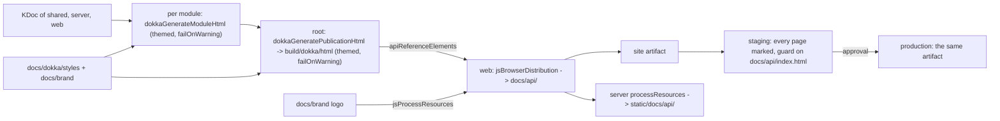

# Plan: the organization's Dokka and project site standard for OrganizationPage

**Covers:** SpartanLaboratories/OrganizationPage#7, "Adopt the organization's Dokka and project site standard".
**Standard:** [`documentation/dokka.md`](https://github.com/SpartanLaboratories/.github/blob/main/documentation/dokka.md) in `SpartanLaboratories/.github`.
**Architecture:** none. This is one system, the documentation build and the site's branding; its shape is in [Design](#6-design).
**Branch:** `feat/issue-7-dokka-and-project-site` (it exists). This plan document is committed in the same commit as the implementation it describes (commit 1 in [Version control](#11-version-control)).
**Plans:** a Dokka 2 API reference for `shared`, `server` and `web`, themed in the site's colours, packaged into the `web` distribution so the site artifact and the server jar both carry it at `/docs/api/`; the organization logo as the site's header mark and favicon; a `docs` job in CI; the deploy workflow's push filter and staging marking adjusted for the new inputs and the new pages, with committed regression tests for both in a test-only `workflow-checks` module.
**Status:** planning only. **Target version:** none; nothing in this repository is published, so no version moves.

---

## 1. Requirements

1. The Dokka reference for `shared`, `server` and `web` is served at `https://spartanlaboratories.org/docs/api/`, inside the existing `site` artifact. It is staged at `/staging/docs/api/`, waits for approval together with the rest of the site, and production receives the same artifact. Nothing is rebuilt for production.
2. Gradle packages the reference into the `web` distribution, so the server jar and the Docker image serve it at `/docs/api/` too. No workflow step copies it.
3. The Spaceship site satisfies the standard's site items: there is no `pages.yml`, no `website/` and no GitHub Pages. The Compose page at `/` is the landing page and gains a link to the reference.
4. The logo is `docs/brand/spartan-laboratories-logo.png`, copied byte for byte from `SpartanLabsGaming/MyGameTools` (`docs/brand/spartan-laboratories-logo.png`: 324,247 bytes, git blob `6b680404171c361cdbcda35e51a45a87776f5f74`).
5. Branding reaches both the Dokka pages and the Compose site: the logo replaces the text "S" mark in the header (`web/src/jsMain/kotlin/com/spartanlaboratories/web/components/Layout.kt:33`) and replaces the favicon. The palette is the site's own navy and amber (`#0b1120`, `#f59e0b`).
6. `failOnWarning` is on in every Dokka configuration, the root and each of the three modules. `reportUndocumented` stays off. No existing declaration gains KDoc in this change.
7. A `docs` job in `.github/workflows/ci.yml` runs `./gradlew dokkaGeneratePublicationHtml`.
8. Dokka 2 in V2 mode (`2.3.0`), the three modules aggregated at the root with `dokka(project(":module"))`, the Kotlin plugins kept `apply false` at the root, and the theme applied at the root and in each module, as the standard says.
9. No javadoc jar and no publishing plugin: no module publishes. No version bump. `README.md`, `CHANGELOG.md` (`[Unreleased]`) and `docs/DEPLOYMENT.md` are updated.
10. Deployment rule 10's text and its exemption are not touched, and nothing about staging, approval, the same-artifact rule or fail-closed behaviour is weakened. `OrganizationPage Deploy` starts for a push that changes `docs/brand/` or `docs/dokka/` (the two folders the site build now reads) and still starts nothing for a push that changes only other files under `docs/`. Every page of the staged reference carries the staging marking.
11. The staging marking step and the push filter have committed regression tests, in a test-only Gradle module, `workflow-checks`, that `./gradlew build` and `check` run. `StagingMarkingTest` runs the committed step body over a fixture of the packaged site, and `DeployPushFilterTest` asserts the filter's patterns and their order. Every module with level-scoped tests has one Gradle task per level.

Acceptance: the Gating checks pass before commit 1; the staging observations (1 in the [Test plan](#9-test-plan)) hold on the staged branch; the production observations (2) hold after landing. The later observations close on their own triggers and do not hold up acceptance.

## 2. Current state

Baseline: `main` at `028231e`; the branch holds only the research commits for this issue on top of it.

**The code this plugs into**

- **The site artifact.** `web` builds with `jsBrowserDistribution` into `web/build/dist/js/productionExecutable` and exposes it as the `webDistribution` consumable configuration (`web/build.gradle.kts:42-52`). `server` resolves it and copies it into its classpath under `static` (`server/build.gradle.kts:41-59`), so one jar serves API and site. The deploy workflow's build job runs `./gradlew check :web:jsBrowserDistribution` and uploads that folder as the `site` artifact (`.github/workflows/deploy-spaceship.yml:67-87`).
- **Where the "S" mark and the favicon live.** The header's `Span({ classes(AppStylesheet.brandMark) }) { Text("S") }` is `Layout.kt:33`; `AppStylesheet.brandMark` is `AppStylesheet.kt:81-91` (a 32 px amber rounded square). `favicon.svg` is referenced only by `web/src/jsMain/resources/index.html:9`.
- **The push filter.** `deploy-spaceship.yml:14-24` has `branches: [main]` and `paths-ignore: 'docs/**'`, with a comment saying the filter is to be removed or narrowed if the site build ever reads `docs/`. The build now reads two folders under `docs/`, so the filter has to change.
- **Staging marking.** `deploy-spaceship.yml:133-144` guards and marks `.deploy/index.html` only (a `<head>` insert of a `noindex, nofollow` meta tag and a `[Staging] ` title prefix, by two `sed` expressions). The reference's pages would reach staging unmarked and indexable.
- **The build has no convention plugin or build-logic**; the three module build files each declare their own plugins and `gradle/libs.versions.toml` is the one version catalog. The root build file applies the Kotlin plugins with `apply false` already (`build.gradle.kts:1-7`). `org.gradle.configuration-cache=true` and `org.gradle.caching=true` are on (`gradle.properties`).
- **The `Dockerfile`** copies the whole checkout (`COPY . .`) and runs `./gradlew --no-daemon :server:buildFatJar`; `.dockerignore` excludes `.git`, `.github`, `.gradle`, `.kotlin` and `**/build`, not `docs/`, so the logo and stylesheet are in the image build context.
- **`ci.yml`** has one job, `build`, running `./gradlew build :server:buildFatJar` on Ubuntu 24.04 with Temurin 21.
- **`server`'s tests** are one class, `server/src/test/kotlin/com/spartanlaboratories/server/ApplicationTest.kt` (kotlin.test and Ktor `testApplication`); `servesWebFrontend` already runs through the real web distribution. They run on JUnit 4: `kotlin("test")` resolves `kotlin-test-junit` and `junit:junit:4.13.2`. `web` has no tests. `shared` has `OrganizationContentTest`.
- **Tests about the workflow files** have no host today: the only JVM test source roots are `server`'s and `shared`'s, and each of those is tied to a site module. `server`'s tests need the whole web distribution, including the Dokka generation, on their classpath.

**Measured on the baseline's build** (Kotlin 2.4.20, Gradle 9.8.0, `org.gradle.configuration-cache=true`):

- Dokka `2.3.0` is the current release on the Gradle Plugin Portal. With the configuration below it generates all three modules and stores a configuration cache entry; there is no dependency cycle between the root's reference output, `web`'s distribution and `server`'s resources.
- With `failOnWarning` on at the root and in all three modules, generation passes and prints no warning.
- With `reportUndocumented` on, Dokka reports 93 undocumented public declarations: 41 in `shared`, 44 in `web`, 8 in `server`.
- A broken KDoc link fails `dokkaGeneratePublicationHtml` (`Couldn't resolve link: [X] in file...`, then `Failed with warningCount=N and errorCount=0`).
- A missing logo or stylesheet file fails `dokkaGeneratePublicationHtml` (`NoSuchFileException: ... The source file doesn't exist.`), and `:web:jsBrowserDistribution` with it.
- The generated aggregate is 199 files and about 3.1 MB before the theme; with the theme `docs/api/` is 3.4 MB. Regenerating gives byte-identical output (no file differs), so after the first upload the FTP sync sends only what changed.
- Every `href` and `src` in every generated page is relative, so the reference works at `/docs/api/` and at `/staging/docs/api/`. File names are plain ASCII; folders start with `-` (for example `-api-error/`).
- Of the 145 HTML files in the packaged site, 141 have exactly one `<head>` and one `<title>` (the site's `index.html` and 140 reference pages). The other four are Dokka's `navigation.html` fragments, with neither; the pages load them by script.
- `:web:jsBrowserDistribution` is a `Sync` task and `:web:jsProcessResources` is a `ProcessResources` task.
- With the packaging below, `web/build/dist/js/productionExecutable` holds 205 files (5.4 MB: `web.js` 967 KB, its source map 743 KB, the logo 324 KB, `docs/api/` 3.4 MB), and the server's `static/` resources hold the same files. `./gradlew check :web:jsBrowserDistribution` produces it, so the deploy workflow needs no copy step.
- The running Ktor server answers: `/docs/api/` 200 with the index; `/docs/api/shared/index.html` 200; `/docs/api/navigation.html` 200; `/docs/api/styles/dokka-styles.css` 200; `/spartan-laboratories-logo.png` 200 `image/png`; `/favicon.svg` 404 once the file is removed; `/api/docs` 404. `/docs/api` with no trailing slash answers 200 with the same page, so its relative links resolve one level up on that form (see [Risks](#10-risks--edge-cases)).
- A selection of every `*.html` under `.deploy` that contains `<head>` (`grep -rlFZ --include='*.html' '<head>' .deploy`) marks 141 pages and leaves the 4 `navigation.html` fragments alone.
- In the packaged site, the home page's `index.html` contains `href="spartan-laboratories-logo.png"`, and `web.js` contains the strings `spartan-laboratories-logo.png` and `docs/api/`.
- The `Mark as staging` step body extracted from the workflow by plain text handling runs correctly under Git for Windows' bash. A process started outside Git Bash on the Windows development machine does not find `bash` on its `PATH`, but `git` is there, and `git --exec-path` leads to Git for Windows' own `bin/bash.exe`. `deploy-spaceship.yml` has CRLF line endings in that working tree, so anything reading it normalises them.
- A test-only module with the configuration in [7.1](#71-gradle) runs its ten tests in about 20 seconds with `--rerun-tasks`, passing from Git Bash and from PowerShell, with none skipped.

**Outside facts this unit rests on**

- The standard's requirements and its CI wording (`dokkaPublications.configureEach { failOnWarning.set(true) }` in every configuration; the theme applied in each module because each module renders its own pages): [`documentation/dokka.md`](https://github.com/SpartanLaboratories/.github/blob/main/documentation/dokka.md). The standard's javadoc-jar and `pages.yml` items apply to libraries and to GitHub Pages sites; neither applies here ([Non-goals](#4-non-goals)).
- Dokka copies `customAssets` into the output's `images/` folder and links `customStyleSheets` after its own sheets; the sibling repository `SpartanLaboratories/WebTools` already runs this setup with `styles/dokka-styles.css` and `--dokka-logo-image-url: url('../images/<logo>.png')`.
- How `paths` filters order and combine patterns, and which dot-named shapes were observed to match `'**'`: [`research/deploy-trigger-paths.md`](research/deploy-trigger-paths.md) (summary in [`research/README.md`](research/README.md)). How the FTP action syncs and what its record can delete: [`../8-docs-only-deploy-skip/research/ftp-deploy-nested-sync.md`](../8-docs-only-deploy-skip/research/ftp-deploy-nested-sync.md).

## 3. Assumptions

| Assumption | If false |
|---|---|
| The logo, with the soft cream glow behind it, reads well on the dark 64 px header and at favicon size. Its lettering is navy, which disappears on navy without the glow; the glow is the treatment the same logo uses on the WebTools site. The owner judges it on staging. | The glow, the size or the background is a CSS edit in `AppStylesheet.brandMark`; a favicon variant would be a separate file (a follow-up). Nothing else changes. |
| The amber values that are not in the site's own palette (`#b45309` for text on light backgrounds, `#92400e` and `#78350f` for filled states, the light slate surfaces) look right in the reference. They are the darker steps of the same amber ramp and the lighter steps of the slate ramp the palette's `#e2e8f0`, `#94a3b8` and `#111a2e` already belong to. The owner judges them on staging. | Token values change in `dokka-styles.css` only; the contrast figures in [7.3](#73-docsdokkastylesdokka-stylescss-new) are the check to repeat. |
| The host answers `/docs/api` (no trailing slash) by redirecting to `/docs/api/` as a directory, which is LiteSpeed's default. | The header link already carries the slash, so no link on the site is affected; only a hand-typed URL without it would show a page with broken relative links. |
| The first upload of about 200 files over FTPS completes within the FTP timeout (`SPACESHIP_FTP_TIMEOUT`, default 90 s per operation). | The upload step fails loudly and the next run resumes from the sync record the failed run did not write; raise `SPACESHIP_FTP_TIMEOUT` and re-run the job. |
| Folder names that start with `-` (`-api-error/`) survive the FTP commands the sync sends (`MKD`, `RMD`, `CWD`). Staging exists to catch this before production. | The staging upload fails or the pages 404 there; the fix would be in the packaging (renaming folders is not possible in Dokka's output), so this would stop the plan and need a different transport for the folder. |
| The three dot-name corners that [`research/deploy-trigger-paths.md`](research/deploy-trigger-paths.md) records as inferred hold: a dot-named file under `docs/` hit by `!docs/**`, a dot-named file inside `docs/brand/` or `docs/dokka/`, and `.dockerignore` alone. Nothing tracked has any of those shapes today. | An extra run (stopped at the production reviewer) or a missed run for such a file; the first such push is the one to watch, and the manual run is the fallback. |

## 4. Non-goals

- A javadoc jar, any publishing plugin or any version bump.
- GitHub Pages, a `website/` folder or a `pages.yml`.
- Writing KDoc or turning on `reportUndocumented`; the 93 undocumented declarations are a follow-up.
- Dokka source links and Dokka's own favicon (`images/logo-icon.svg` stays in the reference pages).
- Resized or special-purpose variants of the logo (a small favicon, an `apple-touch-icon`).
- A link from `docs/index.html` (the documents landing page) to the reference.
- A redirect for `/docs/api` on the Ktor server.
- A convention plugin or build-logic: the build has none, and three modules take one shared `allprojects` hook.
- Any change to `publish-docs.yml`, `.github/actions/spaceship-deploy/action.yml`, the production job, the approval gate or rule 10.
- Moving the existing `ApplicationTest` into a level-scoped package; it is not touched.

## 5. Error handling, logging and documentation approach

The changes are Gradle Kotlin DSL, one shell step body, workflow YAML, one Compose composable edit, one CSS file and Markdown. The only new Kotlin types are the test classes and their two support objects; no production function is added, so no new `Result`-returning signature exists. `SiteHeader(name: String)` keeps its signature. The equivalents, which the file-by-file section applies:

- **Failure path beside the happy path.**
  - *Documentation build.* An expected failure (a KDoc warning of any kind, for example a link that does not resolve) fails `dokkaGeneratePublicationHtml` because `failOnWarning` is on in every configuration. Dokka reports the file and the link; the task's red status is the one place the failure is unwrapped. A missing stylesheet or logo file is a programmer error: it fails the Dokka task with `NoSuchFileException`, and nothing recovers it.
  - *Staging marking.* The two existing guards on `.deploy/index.html` stay as they are: `grep -q` under `set -euo pipefail` fails the step with no annotation. The new guard (the reference missing from the artifact, or its index without `<head>` or `<title>`) ends the step with `exit 1` and an `::error::` annotation naming the file, written to stderr. Nothing is skipped silently in either case; the job's red status is the unwrap point.
  - *Tests.* A failed expectation throws through kotlin.test's assertions, which is what a test is for; no `Result` is involved.
- **Events logged.** Gradle's task output and Dokka's warning lines (the `Couldn't resolve link` line and `Failed with warningCount=` line on failure); the staging step's `::error::` annotations. Nothing logs a secret; this change touches no credential. The server's existing call logging records the requests for `/docs/api/...`; no logging code changes.
- **Stability tier.** No consumer-facing API changes. `SiteHeader` is an internal composable of an application module; no tier marker applies.
- **Documentation rings.** Ring 1: comments in `build.gradle.kts`, `web/build.gradle.kts`, `workflow-checks/build.gradle.kts`, the workflow files and the stylesheet. Ring 2 (KDoc): the only new public declarations are the test classes and their two support objects, which get KDoc comments; no existing declaration's KDoc changes, so the reference shows the KDoc the modules already have. Ring 3 (boundary and protocol): `docs/DEPLOYMENT.md`. Ring 4 (topology): the README's module table, hosting and deployment sections.
- **README currency and CHANGELOG.** The change adds a task, a CI job, a module output and a deployment trigger, so `README.md` and `CHANGELOG.md` are updated in the documentation pass ([commit 2](#11-version-control)); `docs/DEPLOYMENT.md` moves with the implementation in commit 1.

## 6. Design

**Responsibility.** The documentation build turns the KDoc of the three modules into one themed API reference and ships it inside the site; the site's header and favicon carry the organization's logo and the header links to the reference. The deployment system stages and ships it as part of the one `site` artifact.

**Seams.** Configuration only, no published API. Two files under `docs/` are site inputs (`docs/brand/spartan-laboratories-logo.png`, `docs/dokka/styles/dokka-styles.css`) and the deployment's push filter names those two folders.

**Shape.**



**Build wiring.** The root project applies Dokka (the Kotlin plugins stay `apply false` there, so Dokka and the Kotlin plugin share one plugin classloader; without it the modules render empty) and aggregates the three modules with `dokka(project(":module"))`. One `allprojects { pluginManager.withPlugin("org.jetbrains.dokka") { ... } }` hook configures what every Dokka configuration must carry (`failOnWarning`, the stylesheet, the logo asset, the footer), so the root and each module get it the same way and no module can forget it. The root exposes `build/dokka/html` as a consumable `api-reference` configuration, built by `dokkaGeneratePublicationHtml`; `web` consumes it through a resolvable configuration, the same pattern `server` already uses for `web`'s distribution, and the `jsBrowserDistribution` sync places it under `docs/api`. The logo is added to `jsProcessResources`, which puts it at the distribution root, where the header image and the favicon reach it by a relative URL. Because the reference is part of `web`'s distribution, every consumer of that distribution (the deploy build, `:server:processResources`, the Docker build) gets it with no extra step, and every one of them runs Dokka: a documentation warning now fails them.

**Deployment wiring.** `docs/brand/` and `docs/dokka/` feed the site build, so the push filter becomes an ordered `paths` list ([`research/deploy-trigger-paths.md`](research/deploy-trigger-paths.md)): every path, then `!docs/**`, then the two folders put back. A push changing only those folders starts the site deployment (through staging and approval) and the documents publish (rule 10, unchanged); a push changing only other `docs/` files starts only the documents publish; everything else is as before. The staging step marks every page of the packaged site, not only `index.html`, so the staged reference is out of search results and visibly staging, and it fails when the reference is missing from the artifact. Production never rebuilds and only runs after staging (`needs: staging`), so the artifact it receives is the one that passed that guard.

**Compose site.** The header's text mark becomes the logo image, restyled as a 48 px square with a cream glow; the nav gets an `API docs` link whose `href` is relative (`docs/api/`) so it resolves at `/`, at `/staging/` and on the Ktor form. The favicon is the same PNG; `favicon.svg` is deleted. The PNG is used for both: one image of 324 KB is the cost of not shipping resized variants (see [Risks](#10-risks--edge-cases)).

**Tests of the workflows.** The marking step enforces deployment rule 6 and the push filter's order decides whether a deployment starts, so both get committed tests. They go in a test-only Gradle module, `workflow-checks`, not in `server`. They exercise nothing of `server`, and `server`'s tests need the whole web distribution, Dokka generation included, on their classpath, so a workflow-only change would pay for a site build to run a shell check; in their own module they compile and run in seconds and belong to no site module. `./gradlew build` and `check` include the module, so both CI and the deploy build run the tests. The module holds no site code, no Dokka plugin and no main sources.

The tests read `.github/workflows/deploy-spaceship.yml` as text. It is a declared input of every test task in the module; without that Gradle would treat a changed workflow as up to date and not run them. The marking test runs under `bash`, which `ci.yml`'s and the deploy workflow's Ubuntu runners have, and which `Bash` finds on Windows through Git for Windows; with no bash available it skips rather than fails.

Each module with level-scoped tests binds them to a Gradle task per level by package (`integrationTest` in `server`; `gatingTest` and `integrationTest` in `workflow-checks`); `test` still runs everything.

**Stage.** A single stage: the build wiring, the pages' branding, the filter and the marking step depend on each other (the reference without the filter would not deploy on a stylesheet-only push; without the marking it would reach staging indexable).

## 7. File-by-file changes

### 7.1 Gradle

**`gradle/libs.versions.toml`** (changed). `[versions]` gains `dokka = "2.3.0"`; `[plugins]` gains `dokka = { id = "org.jetbrains.dokka", version.ref = "dokka" }`. Nothing else.

**`build.gradle.kts`** (changed; root). Final content:

```kotlin
plugins {
    alias(libs.plugins.kotlin.multiplatform) apply false
    alias(libs.plugins.kotlin.jvm) apply false
    alias(libs.plugins.kotlin.serialization) apply false
    alias(libs.plugins.compose.compiler) apply false
    alias(libs.plugins.ktor) apply false
    alias(libs.plugins.dokka)
}

allprojects {
    group = "com.spartanlaboratories"
    version = "0.1.0"
}

// The API reference of all three modules, aggregated into one publication (build/dokka/html).
dependencies {
    dokka(project(":shared"))
    dokka(project(":server"))
    dokka(project(":web"))
}

dokka {
    moduleName.set("OrganizationPage")
}

// One place for what every Dokka configuration must carry, the root aggregate and each module alike:
// each module renders its own pages with its own configuration, and the root block styles only the
// aggregate index. The build has no convention plugin, so the hook lives here.
//  - failOnWarning: without it a broken KDoc link is only a warning and the build passes.
//  - reportUndocumented is left at its default (off): the existing declarations carry no KDoc yet.
allprojects {
    pluginManager.withPlugin("org.jetbrains.dokka") {
        extensions.configure<org.jetbrains.dokka.gradle.DokkaExtension> {
            dokkaPublications.configureEach { failOnWarning.set(true) }
            pluginsConfiguration.named<org.jetbrains.dokka.gradle.engine.plugins.DokkaHtmlPluginParameters>("html") {
                customStyleSheets.from(rootDir.resolve("docs/dokka/styles/dokka-styles.css"))
                // Dokka copies custom assets into images/; the stylesheet's logo token points there.
                customAssets.from(rootDir.resolve("docs/brand/spartan-laboratories-logo.png"))
                footerMessage.set("&copy; 2026 Spartan Laboratories")
            }
        }
    }
}

// Hands the aggregated reference to the web distribution, the same way web hands its distribution to server.
configurations.consumable("apiReferenceElements") {
    attributes { attribute(Usage.USAGE_ATTRIBUTE, objects.named("api-reference")) }
    outgoing.artifact(layout.buildDirectory.dir("dokka/html")) {
        type = ArtifactTypeDefinition.DIRECTORY_TYPE
        builtBy(tasks.named("dokkaGeneratePublicationHtml"))
    }
}
```

Contract: a Dokka warning fails the build (expected failure, surfaced as the task failure); a missing stylesheet or logo is a programmer error that fails the Dokka task (measured, see [Current state](#2-current-state)). Everything is `val`/declarative; the configuration is read at configuration time, so it is configuration-cache compatible (measured). The footer year is a literal on purpose: a computed year would make the output differ from one year to the next and break the byte-identical regeneration the FTP sync relies on.

**`shared/build.gradle.kts`, `server/build.gradle.kts`, `web/build.gradle.kts`** (changed). Each `plugins { ... }` block gains `alias(libs.plugins.dokka)` as its first line. Nothing else changes in `shared` or `server`.

**`web/build.gradle.kts`** (changed, additionally), appended after the existing `webDistribution` consumable configuration:

```kotlin
// The API reference built at the root, placed in the distribution under docs/api so the site
// artifact, the server jar and the Docker image all serve it at /docs/api/.
val apiReferenceDep = configurations.dependencyScope("apiReference")
val apiReferenceFiles = configurations.resolvable("apiReferenceFiles") {
    extendsFrom(apiReferenceDep.get())
    attributes { attribute(Usage.USAGE_ATTRIBUTE, objects.named("api-reference")) }
}
dependencies { apiReferenceDep(project(":")) }
tasks.named<Sync>("jsBrowserDistribution") {
    from(apiReferenceFiles) { into("docs/api") }
}
// The organization logo: the header mark and the favicon, at the distribution root.
tasks.named<ProcessResources>("jsProcessResources") {
    from(rootDir.resolve("docs/brand/spartan-laboratories-logo.png"))
}
```

Failure: a Gradle copy spec on its own would skip a missing file, but the logo is also a Dokka `customAssets` input, so a missing logo fails the Dokka task and, through the `builtBy` edge, `jsBrowserDistribution` with it (measured); the same holds for a missing stylesheet and for any other Dokka failure.

**`settings.gradle.kts`** (changed). After `include(":web")` add:

```kotlin
// workflow-checks: tests of the GitHub Actions workflows; holds no site code
include(":workflow-checks")
```

**`server/build.gradle.kts`** (changed, additionally), appended at the end of the file:

```kotlin
// The integration tests (the testing.integration package) on their own; `test` runs every test.
tasks.register<Test>("integrationTest") {
    description = "Runs the integration tests."
    group = "verification"
    testClassesDirs = sourceSets.test.get().output.classesDirs
    classpath = sourceSets.test.get().runtimeClasspath
    filter { includeTestsMatching("com.spartanlaboratories.testing.integration.*") }
}
```

The task uses the same JUnit 4 framework as `test`. With no class in the package, Gradle fails the task rather than passing it empty, so a renamed package is noticed.

**`workflow-checks/build.gradle.kts`** (new). Final content:

```kotlin
// Tests of the GitHub Actions workflows. This module holds only tests: they need none of the
// site's build, and they are the deployment workflows' regression guard.
plugins {
    alias(libs.plugins.kotlin.jvm)
}

kotlin {
    jvmToolchain(21)
}

dependencies {
    testImplementation(kotlin("test"))
}

// The tests read the workflows from the repository, so the workflows are test inputs: without
// this, Gradle would treat a changed workflow as up to date and skip them.
tasks.withType<Test>().configureEach {
    inputs.dir(rootDir.resolve(".github/workflows"))
        .withPathSensitivity(PathSensitivity.RELATIVE)
        .withPropertyName("workflows")
}

// One task per test level, by package; `test` runs them all.
fun registerLevelTest(name: String, level: String) = tasks.register<Test>(name) {
    description = "Runs the $level tests of the workflows."
    group = "verification"
    testClassesDirs = sourceSets.test.get().output.classesDirs
    classpath = sourceSets.test.get().runtimeClasspath
    filter { includeTestsMatching("com.spartanlaboratories.testing.$level.*") }
}

registerLevelTest("gatingTest", "gating")
registerLevelTest("integrationTest", "integration")
```

The module applies no Dokka plugin, so the root's Dokka hook and aggregate leave it out, and it has no main sources. The test classes are in [7.7](#77-workflow-checks-tests-new).

### 7.2 Compose site and resources

**`web/src/jsMain/resources/index.html`** (changed). Line 9 becomes `    <link rel="icon" href="spartan-laboratories-logo.png" type="image/png" />`. The relative `href` works at `/`, `/staging/` and from the server. **`web/src/jsMain/resources/favicon.svg`** is deleted; nothing else references it. The live production sync record lists it, so the next production deployment removes it from the host, as does staging's.

**`web/src/jsMain/kotlin/com/spartanlaboratories/web/components/Layout.kt`** (changed). Imports: add `org.jetbrains.compose.web.dom.Img` (between `Header` and `Nav`); remove `org.jetbrains.compose.web.dom.Span` (no longer used in this file). `SiteHeader(name: String)` keeps its signature (no `Result`, no thrown exception; it is a composable that cannot fail on its own) and becomes:

```kotlin
@Composable
fun SiteHeader(name: String) {
    Header({ classes(AppStylesheet.header) }) {
        Div({ classes(AppStylesheet.container, AppStylesheet.headerInner) }) {
            A("#top", { classes(AppStylesheet.brand) }) {
                // Empty alt: the organization's name is the adjacent text, so the image is decoration.
                Img(src = "spartan-laboratories-logo.png", alt = "", attrs = { classes(AppStylesheet.brandMark) })
                Text(name)
            }
            Nav({ classes(AppStylesheet.nav) }) {
                PageSection.entries.forEach { section ->
                    A("#${section.id}", { classes(AppStylesheet.navLink) }) { Text(section.label) }
                }
                // Relative on purpose: the same link works at /, at /staging/ and when the Ktor server serves the site.
                A("docs/api/", { classes(AppStylesheet.navLink) }) { Text("API docs") }
            }
        }
    }
}
```

**`web/src/jsMain/kotlin/com/spartanlaboratories/web/styles/AppStylesheet.kt`** (changed: `brandMark`, lines 81-91). It becomes the image style: a 48 px square inside the 64 px header, a cream glow behind it, no border radius:

```kotlin
    val brandMark by style {
        width(48.px)
        height(48.px)
        property("flex-shrink", 0)
        // The logo is nearly square; contain keeps its proportions inside the square box.
        property("object-fit", "contain")
        // The logo's lettering is navy and disappears on the navy header; this soft cream glow, the
        // one the same logo has on the WebTools site, sits behind it and fades out before the box
        // edge. No border radius: it would clip the logo's corners.
        property(
            "background",
            "radial-gradient(circle closest-side, rgba(238, 226, 204, 0.78), rgba(192, 160, 128, 0.32) 62%, transparent 100%)",
        )
    }
```

`Palette.accentText` is still used elsewhere (line 166); no other style changes. The `Palette` object is unchanged.

### 7.3 `docs/dokka/styles/dokka-styles.css` (new)

Adapted from `SpartanLaboratories/WebTools`' `docs/dokka/styles/dokka-styles.css` (246 lines, navy and bronze). The structure, the region comments, every selector and the `--dokka-logo-image-url` use stay; every brand value is replaced by this site's palette (`AppStylesheet.kt:5-13`: background `#0b1120`, surface `#111a2e`, border `#1f2a44`, text `#e2e8f0`, muted `#94a3b8`, accent `#f59e0b`, accent text `#1a1204`; `#fbbf24` is the hover). The navigation bar stays dark in both themes. Text that sits on a light background uses the darker amber `#b45309`, because `#f59e0b` on white is 2.05:1 and does not meet text contrast; `#f59e0b` stays for accents on dark surfaces and for non-text highlights (rules, borders, the active-row bar). The cream logo glow is kept as it is.

Token table. Light values are the `:root` defaults; dark values are set on `.theme-dark` (Dokka adds that class to `<html>`). A dash in the dark column means the light value applies in both themes.

| Token | Light | Dark | Role (and the WebTools value it replaces) |
|---|---|---|---|
| `--sl-ink` | `#0b1120` | - | Navigation bar and dark chrome (`#0e1c2e`) |
| `--sl-ink-raised` | `#111a2e` | - | Raised dark surface: dark footer, dark code blocks (`#16263a`) |
| `--sl-accent` | `#f59e0b` | - | Non-text accent: rules, borders, highlight bars, dark-theme headings and links (`--sl-bronze` `#907040`) |
| `--sl-accent-hover` | `#fbbf24` | - | Hover on dark surfaces, dark-theme link hover, dark-theme keyword (`--sl-bronze-soft` `#C0A080`, `#e0c9ac`) |
| `--sl-accent-text` | `#b45309` | - | Text, links and headings on light backgrounds (`--sl-navy` `#103050`) |
| `--sl-accent-text-hover` | `#92400e` | - | Hover for `--sl-accent-text` (`--sl-navy-hover` `#1a4673`) |
| `--sl-accent-text-50` | `rgba(180, 83, 9, 0.5)` | - | Half-strength ring for the light theme (`--sl-navy-50`) |
| `--color-key-blue` | `var(--sl-accent-text)` | `#78350f` | Filled key colour (active sidebar row, active tab fill); its text is the near-white `--color-text-dt`, so the fill is kept dark enough in both themes |
| `--color-key-blue-hover` | `var(--sl-accent-text-hover)` | `#92400e` | Key colour hover |
| `--color-key-blue-50` | `var(--sl-accent-text-50)` | `rgba(245, 158, 11, 0.5)` | Focus rings |
| `--color-background-nav` | `var(--sl-ink)` | - | Nav bar |
| `--color-background-nav-dt` | `var(--sl-ink)` | - | Nav bar in dark theme: stays dark in both |
| `--color-background-page` | `#f8fafc` | - | Light page (`#f7f5ef`) |
| `--color-background-page-dt` | `var(--sl-ink)` | - | Dark page (`#101a26`) |
| `--color-background-footer` | `#e2e8f0` | - | Light footer (`#e9e3d4`) |
| `--color-background-footer-dt` | `var(--sl-ink-raised)` | - | Dark footer |
| `--background-color` | `var(--color-background-page)` | `var(--color-background-page-dt)` | Page background |
| `--color-background` | not set | `var(--color-background-page-dt)` | Dokka's own page-background token, dark only |
| `--color-text`, `--default-font-color` | `#0b1120` | `#e2e8f0` (`--default-font-color`) | Body text (`#14202e`, `#e8edf3`) |
| `--color-text-light` | `rgba(11, 17, 32, 0.72)` | - | Secondary text, light |
| `--color-text-dt` | not set (Dokka's near-white) | `#e2e8f0` | Text on dark surfaces, including the nav bar and the active row |
| `--color-text-light-dt` | not set | `#94a3b8` | Secondary text, dark (the site's muted colour) |
| `--hover-link-color`, `--active-section-color`, `--sidemenu-section-active-color` | `var(--sl-accent-text)` | `var(--sl-accent)` | Link hover and active section text |
| `--active-tab-border-color` | `var(--sl-accent-text)` | `var(--sl-accent)` | Tab underline (WebTools left this navy in the dark theme, where it vanishes) |
| `--border-color` | `rgba(11, 17, 32, 0.16)` | `#1f2a44` | Hairlines (the site's border colour in dark) |
| `--navigation-highlight-color` | `rgba(180, 83, 9, 0.08)` | `rgba(245, 158, 11, 0.08)` | Navigation highlight |
| `--blockquote-background` | `rgba(180, 83, 9, 0.06)` | `rgba(245, 158, 11, 0.06)` | Quote background |
| `--color-background-inline-code` | `rgba(11, 17, 32, 0.07)` | `rgba(245, 158, 11, 0.12)` | Inline code |
| `--color-background-code-block` | `#ffffff` | `var(--sl-ink-raised)` | Code blocks (white keeps the keyword colour above 4.5:1) |
| `--toc-hover-color` | `rgba(180, 83, 9, 0.10)` | `rgba(245, 158, 11, 0.10)` | Sidebar row hover |
| `--color-cd-keyword` | `var(--sl-accent-text)` | - | Code keyword |
| `--color-cd-keyword-alternative` | not set | `var(--sl-accent-hover)` | Code keyword, dark (Dokka reads the `-alternative` set in dark) |
| `--color-cd-builtin` / `-alternative` | `#2f6f3e` | `#a8d8a0` | Code built-in (syntax colour, unchanged) |
| `--color-cd-function` / `-alternative` | `#1f2a44` | `#e2e8f0` | Code function (`#7a5a28`, `#f0d9a8`) |
| `--color-cd-number` / `-alternative` | `#6b2fa0` | `#c49bf0` | Code number (syntax colour, unchanged) |
| `--color-cd-operator` / `-alternative` | `#475569` | `#94a3b8` | Code operator (`#6b5a40`, `#b4c0ce`) |
| `--dokka-logo-image-url` | `url('../images/spartan-laboratories-logo.png')` | - | Logo (Dokka copies customAssets into `images/`, stylesheets into `styles/`) |
| `--dokka-logo-height`, `--dokka-logo-width` | `56px` | - | Logo box (unchanged) |
| `--sl-header-bg` | `linear-gradient(90deg, var(--sl-ink) 0%, var(--sl-ink-raised) 100%)` | - | Nav bar wash; the bar is the same in both themes, so the dark block carries no copy |
| `--sl-logo-glow` | `radial-gradient(circle closest-side, rgba(238, 226, 204, 0.78), rgba(192, 160, 128, 0.32) 62%, transparent 100%)` | - | Cream glow behind the logo, kept as is |
| `--sl-sidebar-tone` | `#f1f5f9` | `var(--sl-ink)` | Sidebar background |
| `--sl-meander` | the WebTools data-URI with stroke `%23b45309`, opacity `0.10` | stroke `%23f59e0b`, opacity `0.07` | Sidebar texture |
| `--sl-content-bg` | `linear-gradient(180deg, #f8fafc 0%, #f1f5f9 100%)` | `linear-gradient(180deg, var(--sl-ink) 0%, var(--sl-ink-raised) 100%)` | Content background |

Rule values (selectors unchanged from WebTools): `.navigation` bottom rule `2px solid var(--sl-accent)`; `.library-name--link:hover` colour `var(--sl-accent-hover)`; `.toc--part[data-active]` inset bar `inset 3px 0 0 var(--sl-accent)`; `.footer` top rule `2px solid var(--sl-accent)`; headings `h1, h2` `var(--sl-accent-text)` in light and `var(--sl-accent)` in dark; content links `var(--sl-accent-text)` with border `rgba(180, 83, 9, 0.3)`, hover `var(--sl-accent-text-hover)`, and in dark `var(--sl-accent)` with border `rgba(245, 158, 11, 0.3)`, hover `var(--sl-accent-hover)`; `blockquote` and the code-block edge `var(--sl-accent)`.

Contrast, computed with the WCAG relative-luminance formula: `#b45309` on `#ffffff` 5.02, on `#f8fafc` 4.80, on `#f1f5f9` 4.58; `#92400e` on `#f8fafc` 6.78; `#0b1120` on `#f8fafc` 18.0; `#f59e0b` on `#0b1120` 8.77 and on `#111a2e` 8.07; `#fbbf24` on `#0b1120` 11.28; `#e2e8f0` on `#0b1120` 15.27 and on `#78350f` 7.36 and on `#92400e` 5.75; `#94a3b8` on `#111a2e` 6.76; near-white (`#fafaf9`) on `#b45309` 4.81. `#f59e0b` on `#f8fafc` is 2.05, which is why it is never used for text on a light background.

Final content of the file:

```css
/*
 * Spartan Laboratories theme for the OrganizationPage API reference.
 *
 * Loaded by the root build.gradle.kts for the aggregate and, through the same allprojects hook, by every
 * module's Dokka configuration via `pluginsConfiguration.html.customStyleSheets`, which Dokka links AFTER
 * its own style.css / main.css / ui-kit.min.css - so a same-specificity rule here wins. Almost everything in
 * Dokka 2.x is driven by CSS custom properties, so the theme is mostly token overrides; the handful of
 * element rules below cover what the tokens don't reach.
 *
 * Palette: the site's own navy (#0b1120) and amber (#f59e0b), see web/.../styles/AppStylesheet.kt.
 * Light theme: slate page, amber-brown text (#b45309; #f59e0b on white fails text contrast). Dark theme:
 * the site's navy page with amber accents. The navigation bar stays dark in both themes.
 * Dokka toggles dark mode by adding `.theme-dark` to <html>; both blocks are needed because ui-kit and
 * style.css each redefine their tokens there.
 */

/* region tokens - light (default) */
:root {
    /* brand */
    --sl-ink: #0b1120;
    --sl-ink-raised: #111a2e;
    --sl-accent: #f59e0b;
    --sl-accent-hover: #fbbf24;
    --sl-accent-text: #b45309;
    --sl-accent-text-hover: #92400e;
    --sl-accent-text-50: rgba(180, 83, 9, 0.5);

    /* ui-kit key colour: active sidebar row, focus rings, tabs, search highlights */
    --color-key-blue: var(--sl-accent-text);
    --color-key-blue-hover: var(--sl-accent-text-hover);
    --color-key-blue-50: var(--sl-accent-text-50);

    /* chrome */
    --color-background-nav: var(--sl-ink);
    --color-background-nav-dt: var(--sl-ink);
    --color-background-page: #f8fafc;
    --color-background-page-dt: var(--sl-ink);
    --color-background-footer: #e2e8f0;
    --color-background-footer-dt: var(--sl-ink-raised);
    --background-color: var(--color-background-page);
    --color-text: #0b1120;
    --default-font-color: #0b1120;
    --color-text-light: rgba(11, 17, 32, 0.72);

    /* style.css accents */
    --hover-link-color: var(--sl-accent-text);
    --active-section-color: var(--sl-accent-text);
    --sidemenu-section-active-color: var(--sl-accent-text);
    --active-tab-border-color: var(--sl-accent-text);
    --border-color: rgba(11, 17, 32, 0.16);
    --navigation-highlight-color: rgba(180, 83, 9, 0.08);
    --blockquote-background: rgba(180, 83, 9, 0.06);
    --color-background-inline-code: rgba(11, 17, 32, 0.07);
    --color-background-code-block: #ffffff;
    --toc-hover-color: rgba(180, 83, 9, 0.10);

    /* code tokens (light) */
    --color-cd-keyword: var(--sl-accent-text);
    --color-cd-builtin: #2f6f3e;
    --color-cd-function: #1f2a44;
    --color-cd-number: #6b2fa0;
    --color-cd-operator: #475569;

    /* logo: Dokka copies customAssets into images/, stylesheets into styles/ */
    --dokka-logo-image-url: url('../images/spartan-laboratories-logo.png');
    --dokka-logo-height: 56px;
    --dokka-logo-width: 56px;
}
/* endregion */

/* region tokens - dark */
.theme-dark {
    /* ui-kit key colour: a filled row with near-white text, so the fill stays dark amber (7.36:1 with #e2e8f0) */
    --color-key-blue: #78350f;
    --color-key-blue-hover: #92400e;
    --color-key-blue-50: rgba(245, 158, 11, 0.5);

    --background-color: var(--color-background-page-dt);
    --color-background: var(--color-background-page-dt);
    --default-font-color: #e2e8f0;
    --color-text-dt: #e2e8f0;
    --color-text-light-dt: #94a3b8;

    --hover-link-color: var(--sl-accent);
    --active-section-color: var(--sl-accent);
    --sidemenu-section-active-color: var(--sl-accent);
    --active-tab-border-color: var(--sl-accent);
    --border-color: #1f2a44;
    --navigation-highlight-color: rgba(245, 158, 11, 0.08);
    --blockquote-background: rgba(245, 158, 11, 0.06);
    --color-background-inline-code: rgba(245, 158, 11, 0.12);
    --color-background-code-block: var(--sl-ink-raised);
    --toc-hover-color: rgba(245, 158, 11, 0.10);

    /* code tokens (dark) - Dokka reads the *-alternative set in dark mode */
    --color-cd-keyword-alternative: var(--sl-accent-hover);
    --color-cd-builtin-alternative: #a8d8a0;
    --color-cd-function-alternative: #e2e8f0;
    --color-cd-operator-alternative: #94a3b8;
    --color-cd-number-alternative: #c49bf0;
}
/* endregion */

/* region chrome */

/* Top bar: amber rule under the navy header. */
.navigation {
    border-bottom: 2px solid var(--sl-accent);
    box-shadow: 0 6px 18px -12px rgba(0, 0, 0, 0.8);
}

.library-name--link {
    letter-spacing: 0.04em;
    text-transform: uppercase;
}

/* ui-kit caps the logo at 36px tall / 120px wide and sizes it with min(); lift the cap so the
   --dokka-logo-* tokens above are honoured as-is. */
.library-name--link:before {
    max-height: none;
    max-width: none;
    background-size: var(--dokka-logo-width) var(--dokka-logo-height);
}

/* Desktop only: trim ui-kit's 12px vertical padding so the 56px logo doesn't grow the bar past
   its usual ~64px height. Below 900px ui-kit already zeroes the padding and wraps the bar. */
@media (min-width: 900px) {
    .navigation {
        padding-top: 4px;
        padding-bottom: 4px;
    }
}

.library-name--link:hover {
    color: var(--sl-accent-hover);
}

/* Sidebar: a hairline in the theme's border colour instead of Dokka's grey one. */
.sidebar {
    border-right: 1px solid var(--border-color);
}

.toc--part[data-active] > .toc--row .toc--link,
.toc--part[data-active] > .toc--row .toc--button {
    box-shadow: inset 3px 0 0 var(--sl-accent);
}

/* Footer: amber top rule so the copyright line reads as a deliberate sign-off. */
.footer {
    border-top: 2px solid var(--sl-accent);
}

/* endregion */

/* region content */

.main-content :is(h1, h2),
h1.cover {
    color: var(--sl-accent-text);
}

.theme-dark .main-content :is(h1, h2),
.theme-dark h1.cover {
    color: var(--sl-accent);
}

/* Content links. Matches ui-kit's `.main-content a:not([data-name])` so the specificity ties
   and this later sheet wins; that rule otherwise paints links in plain body text colour. */
.main-content a:not([data-name]) {
    color: var(--sl-accent-text);
    border-bottom-color: rgba(180, 83, 9, 0.3);
}

.main-content a:not([data-name]):hover {
    color: var(--sl-accent-text-hover);
    border-bottom-color: var(--sl-accent-text-hover);
}

.theme-dark .main-content a:not([data-name]) {
    color: var(--sl-accent);
    border-bottom-color: rgba(245, 158, 11, 0.3);
}

.theme-dark .main-content a:not([data-name]):hover {
    color: var(--sl-accent-hover);
    border-bottom-color: var(--sl-accent-hover);
}

blockquote {
    border-left: 4px solid var(--sl-accent);
}

/* Code blocks: a thin amber edge sets them apart from prose in both themes. */
.sample-container,
code.block.monospace {
    border-left: 3px solid var(--sl-accent);
}

/* endregion */

/* region backgrounds
 * One calm treatment per surface, from the same navy/amber family:
 *   header  - slow horizontal wash, ink into the raised navy (the same in both themes)
 *   logo    - soft cream glow so the navy lettering stays legible on the always-dark header
 *   sidebar - faint Greek-key (meander) texture over a slightly deeper tone
 *   content - gentle vertical gradient, fixed while the page scrolls
 * Every layer stays low-contrast so text and code keep their normal legibility.
 */
:root {
    --sl-header-bg: linear-gradient(90deg, var(--sl-ink) 0%, var(--sl-ink-raised) 100%);
    --sl-logo-glow: radial-gradient(circle closest-side, rgba(238, 226, 204, 0.78), rgba(192, 160, 128, 0.32) 62%, transparent 100%);
    --sl-sidebar-tone: #f1f5f9;
    --sl-meander: url("data:image/svg+xml,%3Csvg xmlns='http://www.w3.org/2000/svg' width='40' height='40' viewBox='0 0 40 40'%3E%3Cpath d='M0 36H36V4H8V28H28V12H16V20' fill='none' stroke='%23b45309' stroke-opacity='0.10' stroke-width='2'/%3E%3C/svg%3E");
    --sl-content-bg: linear-gradient(180deg, #f8fafc 0%, #f1f5f9 100%);
}

.theme-dark {
    --sl-sidebar-tone: var(--sl-ink);
    --sl-meander: url("data:image/svg+xml,%3Csvg xmlns='http://www.w3.org/2000/svg' width='40' height='40' viewBox='0 0 40 40'%3E%3Cpath d='M0 36H36V4H8V28H28V12H16V20' fill='none' stroke='%23f59e0b' stroke-opacity='0.07' stroke-width='2'/%3E%3C/svg%3E");
    --sl-content-bg: linear-gradient(180deg, var(--sl-ink) 0%, var(--sl-ink-raised) 100%);
}

.navigation {
    background-image: var(--sl-header-bg);
}

/* The glow is painted behind the logo image itself: the logo's own background layer comes
   first (on top), the glow second. */
.library-name--link:before {
    background: var(--dokka-logo-image-url) center / var(--dokka-logo-width) var(--dokka-logo-height) no-repeat,
                var(--sl-logo-glow) center / 100% 100% no-repeat;
    /* No border-radius: it would clip the logo's corners. The glow already fades out
       before the box edge, so the square box never shows. */
    border-radius: 0;
}

.sidebar {
    background-color: var(--sl-sidebar-tone);
    background-image: var(--sl-meander);
}

#main {
    background-image: var(--sl-content-bg);
    background-attachment: fixed;
}

/* endregion */
```

The file is written with LF line endings and four-space indentation, as the WebTools original.

### 7.4 `docs/brand/spartan-laboratories-logo.png` (new, binary)

Copied byte for byte from `SpartanLabsGaming/MyGameTools` (`gh api repos/SpartanLabsGaming/MyGameTools/contents/docs/brand/spartan-laboratories-logo.png -H "Accept: application/vnd.github.raw"`). 324,247 bytes, 566 by 559 pixels, 8-bit RGBA, git blob `6b680404171c361cdbcda35e51a45a87776f5f74` (the same blob as `SpartanLaboratories/WebTools`' copy). It is the single source for the Dokka pages (`customAssets`), the header mark and the favicon (`jsProcessResources`).

### 7.5 Workflows

**`.github/workflows/ci.yml`** (changed: one job added after `build`). Same runner, actions and style as `build`:

```yaml
  docs:
    name: API docs (Dokka)
    runs-on: ubuntu-24.04

    steps:
      - name: Checkout repository
        uses: actions/checkout@v6

      - name: Setup Java
        uses: actions/setup-java@v5
        with:
          distribution: temurin
          java-version: 21

      - name: Setup Gradle
        uses: gradle/actions/setup-gradle@v5

      - name: Generate API reference
        run: ./gradlew dokkaGeneratePublicationHtml
```

Failure: the Gradle task fails the job when Dokka reports any warning (`failOnWarning`); the job's red status is the unwrap point. The `build` job is unchanged and, because `check` and `build` now run Dokka through the web distribution, it also fails on a warning; the dedicated job is the named signal the standard asks for and runs in parallel with it. `ci.yml` does not run on `main`; there the deploy build's `./gradlew check :web:jsBrowserDistribution` generates the same reference, so every build runs the Dokka task.

**`.github/workflows/deploy-spaceship.yml`** (changed in two places; nothing else in the file changes).

(a) `on.push`: replace the comment and `paths-ignore` (lines 18-22) with exactly this comment and filter, keeping `branches` and `workflow_dispatch` as they are:

```yaml
    # Every push starts a run except one that changes only files under docs/, which
    # publish-docs.yml puts live on its own. The two folders under docs/ that the site
    # build reads, brand/ and dokka/, are put back so a change there deploys. Patterns
    # are checked in order and the last one that matches a path decides: keep '!docs/**'
    # after '**' and the two re-includes after '!docs/**'. If the site build starts
    # reading another folder under docs/, add it below.
    paths:
      - '**'
      - '!docs/**'
      - 'docs/brand/**'
      - 'docs/dokka/**'
```

Failure behaviour: declarative. The filter's failure direction is a missed run: a new site input under `docs/` that is not listed leaves a push touching only it without a deployment until it is listed (the comment and `docs/DEPLOYMENT.md` say so). The order is load-bearing: moving a re-include above `'!docs/**'` silently removes it.

(b) The `Mark as staging` step (lines 133-144) becomes:

```yaml
      - name: Mark as staging
        shell: bash
        run: |
          set -euo pipefail
          # Keep staging out of search results and easy to tell apart in a browser tab.
          # This only changes the staging upload; production gets the artifact as built.
          # Every page of the site is marked: the home page and each page of the API reference.
          grep -q '<head>' .deploy/index.html
          grep -q '<title>' .deploy/index.html

          # The reference must be in the artifact, and its index must be a markable page.
          reference=.deploy/docs/api/index.html
          if [[ ! -f "$reference" ]]; then
            echo "::error::The site artifact has no API reference ($reference); the Dokka output was not packaged, so nothing was staged." >&2
            exit 1
          fi
          if ! grep -q '<head>' "$reference" || ! grep -q '<title>' "$reference"; then
            echo "::error::$reference has no <head> or <title>, so it cannot be marked as staging and nothing was staged." >&2
            exit 1
          fi

          # Dokka's navigation.html files are fragments that its pages load by script: they have
          # no <head> and are not pages of their own, so only files that have a <head> are marked.
          pages=()
          while IFS= read -r -d '' f; do pages+=("$f"); done \
            < <(grep -rlFZ --include='*.html' '<head>' .deploy)
          sed -i \
            -e 's|<head>|<head>\n    <meta name="robots" content="noindex, nofollow" />|' \
            -e 's|<title>|<title>[Staging] |' \
            "${pages[@]}"
```

Contract: the two `.deploy/index.html` guards stay as they are; the reference guard fails with `::error::` before any file is modified (the selection and `sed` come after it), so a failed step leaves the artifact untouched. The array is never empty because `.deploy/index.html` passed its guard. The pages carry the same two edits as before. The `Summary`, `Deploy to staging`, approval and production jobs, and `.github/actions/spaceship-deploy/action.yml`, are unchanged. The production job needs no copy of the guard: it runs only after `staging` (`needs: staging`) and receives the same artifact.

### 7.6 `server/src/test/kotlin/com/spartanlaboratories/testing/integration/server/ApiReferenceServingTest.kt` (new)

Integration test (`testing.integration`). It runs the real module through Ktor's `testApplication` against the real packaged web distribution on the test classpath, like `ApplicationTest.servesWebFrontend`. No network, no GitHub, no live host.

```kotlin
package com.spartanlaboratories.testing.integration.server

/**
 * Integration: the web distribution packaged on the server's classpath carries the API reference
 * at /docs/api/ and the organization logo, and no longer carries the old favicon; the home page and
 * the bundle reference the logo and the reference link.
 */
class ApiReferenceServingTest {
    private fun testApp(block: suspend ApplicationTestBuilder.() -> Unit) = testApplication {
        application { module() }
        block()
    }

    @Test fun referenceIndexIsServed() = testApp { /* GET /docs/api/ */ }
    @Test fun moduleIndexIsServed() = testApp { /* GET /docs/api/shared/index.html */ }
    @Test fun themeStylesheetIsServed() = testApp { /* GET /docs/api/styles/dokka-styles.css */ }
    @Test fun logoIsServedInsideTheReference() = testApp { /* GET /docs/api/images/spartan-laboratories-logo.png */ }
    @Test fun logoIsServedAtTheSiteRoot() = testApp { /* GET /spartan-laboratories-logo.png */ }
    @Test fun oldSvgFaviconIsNotServed() = testApp { /* GET /favicon.svg */ }
    @Test fun navigationFragmentIsServed() = testApp { /* GET /docs/api/navigation.html */ }
    @Test fun pageUnderADashPrefixedFolderIsServed() = testApp { /* GET /docs/api/shared/com.spartanlaboratories.shared.model/-organization/index.html */ }
    @Test fun unknownPathUnderTheReferenceIsNotFound() = testApp { /* GET /docs/api/no-such-page.html */ }
    @Test fun theReferenceIsNotUnderTheJsonApi() = testApp { /* GET /api/docs */ }
    @Test fun homePageUsesTheLogoAsFavicon() = testApp { /* GET / */ }
    @Test fun webBundleCarriesTheHeaderLogoAndTheReferenceLink() = testApp { /* GET /web.js */ }
}
```

The class imports what it uses. Each test makes one request and asserts: `referenceIndexIsServed` 200, `contentType()` matches `ContentType.Text.Html`, body contains `styles/dokka-styles.css`; `moduleIndexIsServed` 200, HTML, and body contains `styles/dokka-styles.css`, because each module renders its own pages with its own theme; `themeStylesheetIsServed` 200 and `ContentType.Text.CSS`; both logo tests 200 and `ContentType.Image.PNG`; `oldSvgFaviconIsNotServed` `HttpStatusCode.NotFound`; `navigationFragmentIsServed` 200; `pageUnderADashPrefixedFolderIsServed` 200 and HTML; `unknownPathUnderTheReferenceIsNotFound` `HttpStatusCode.NotFound`; `theReferenceIsNotUnderTheJsonApi` `HttpStatusCode.NotFound`; `homePageUsesTheLogoAsFavicon` 200 and body contains `href="spartan-laboratories-logo.png"`; `webBundleCarriesTheHeaderLogoAndTheReferenceLink` 200 and body contains both `"spartan-laboratories-logo.png"` and `"docs/api/"` with their quotes, the strings the Compose header puts into the bundle, which pins them to the relative form. Failure path: a failed expectation throws through kotlin.test's assertions; there is nothing to recover and no `Result`. Immutability: no state; the helper builds a fresh `testApplication` per test. No MockK: nothing external is mocked at this level, the test deliberately uses the real distribution.

### 7.7 `workflow-checks` tests (new)

Four files under `workflow-checks/src/test/kotlin/com/spartanlaboratories/testing/`, on the JUnit 4 that `kotlin("test")` resolves. Each class is in its own file.

`support/workflows/DeployWorkflow.kt` reads the workflow as text and hands out the body of a step. No YAML parser is added for this; the file's own layout is what the checks rely on, and a reformat that breaks it fails the tests loudly:

```kotlin
package com.spartanlaboratories.testing.support.workflows

import java.io.File

/**
 * `.github/workflows/deploy-spaceship.yml` read as text, with LF line endings. Gradle runs a test from
 * its module folder, so the repository root is one level up. No YAML parser is on the test classpath;
 * the two checks that use this rely on the file's own layout.
 */
object DeployWorkflow {
    val lines: List<String> = File("../.github/workflows/deploy-spaceship.yml")
        .readText()
        .replace("\r\n", "\n")
        .lines()

    /**
     * The body of the named step's `run: |` block, without its indentation.
     *
     * @throws IllegalStateException when the step or its `run: |` block is not in the file.
     */
    fun runBlockOf(stepName: String): String {
        val stepLine = lines.indexOfFirst { it.trim() == "- name: $stepName" }
        check(stepLine >= 0) { "The deploy workflow has no step named '$stepName'." }
        val offset = lines.drop(stepLine).indexOfFirst { it.trim() == "run: |" }
        check(offset >= 0) { "The step '$stepName' has no 'run: |' block." }
        val body = lines.drop(stepLine + offset + 1)
        val indent = body.first().length - body.first().trimStart().length
        return body
            .takeWhile { it.isBlank() || it.startsWith(" ".repeat(indent)) }
            .joinToString("\n") { it.drop(indent) }
    }
}
```

`support/workflows/Bash.kt` finds the shell. `bash` on the `PATH` is used where there is one; Windows falls back to the one Git for Windows ships, because a process started outside Git Bash has no `bash` on its `PATH`:

```kotlin
package com.spartanlaboratories.testing.support.workflows

import java.io.File

/** Finds a bash to run workflow step bodies with: `bash` on the PATH, or the one Git for Windows ships. */
object Bash {
    val executable: String? by lazy {
        (listOf("bash") + gitForWindowsBash()).firstOrNull(::runs)
    }

    private fun gitForWindowsBash(): List<String> {
        if (!System.getProperty("os.name").startsWith("Windows")) return emptyList()
        return runCatching {
            val execPath = ProcessBuilder("git", "--exec-path").start().inputStream.bufferedReader().readText().trim()
            File(execPath).resolve("../../../bin/bash.exe").normalize().path
        }.fold(onSuccess = { listOf(it) }, onFailure = { emptyList() })
    }

    private fun runs(candidate: String): Boolean = runCatching {
        ProcessBuilder(candidate, "-c", "exit 0").start().waitFor() == 0
    }.getOrDefault(false)
}
```

`gating/workflows/DeployPushFilterTest.kt`, package `com.spartanlaboratories.testing.gating.workflows`:

```kotlin
package com.spartanlaboratories.testing.gating.workflows

import com.spartanlaboratories.testing.support.workflows.DeployWorkflow
import kotlin.test.Test
import kotlin.test.assertEquals
import kotlin.test.assertTrue

/**
 * The deploy workflow's push filter is ordered, and a mistake in it leaves no run and no error: GitHub
 * just starts nothing. The folders under docs/ that feed the site build must stay after the exclusion.
 */
class DeployPushFilterTest {
    private val lines = DeployWorkflow.lines
    private val pathsLine = lines.indexOfFirst { it.trim() == "paths:" }

    @Test
    fun patternsAreListedInOrder() {
        val patterns = lines.drop(pathsLine + 1).takeWhile { it.trimStart().startsWith("- ") }.map { it.trim() }
        assertEquals(listOf("- '**'", "- '!docs/**'", "- 'docs/brand/**'", "- 'docs/dokka/**'"), patterns)
    }

    @Test
    fun filterSitsUnderThePushEvent() {
        val push = lines.indexOf("  push:")
        val dispatch = lines.indexOf("  workflow_dispatch:")
        assertTrue(push in 0 until pathsLine && pathsLine < dispatch, "paths: must sit between push: and workflow_dispatch:")
    }

    @Test
    fun theOldIgnoreFilterIsGone() {
        assertTrue(lines.none { "paths-ignore" in it })
    }
}
```

`integration/workflows/StagingMarkingTest.kt`, package `com.spartanlaboratories.testing.integration.workflows`, runs the committed step body in bash over a small fixture: the home page, a reference page, a nested reference page, a deeper page under a `-` prefixed folder, two `navigation.html` fragments and a non-HTML file. It asserts the marks, that the fragments and the other file are left as built, and the exit cases. With no bash on the host the tests skip, through JUnit 4's `Assume`; on the Ubuntu runners bash is always there.

```kotlin
package com.spartanlaboratories.testing.integration.workflows

import com.spartanlaboratories.testing.support.workflows.Bash
import com.spartanlaboratories.testing.support.workflows.DeployWorkflow
import java.io.File
import java.util.concurrent.TimeUnit
import kotlin.io.path.createTempDirectory
import kotlin.test.AfterTest
import kotlin.test.BeforeTest
import kotlin.test.Test
import kotlin.test.assertContentEquals
import kotlin.test.assertEquals
import kotlin.test.assertNotEquals
import kotlin.test.assertTrue
import org.junit.Assume.assumeTrue

/**
 * Runs the `Mark as staging` step of the deploy workflow, as committed, over a small fixture of the
 * packaged site. The step keeps staging out of search results and marks it visibly, so a change that
 * stops marking pages would otherwise show only as staged pages indexed by accident.
 */
class StagingMarkingTest {
    private val root: File = createTempDirectory("staging-marking").toFile()
    private val deploy = root.resolve(".deploy")

    private val pages = listOf(
        "index.html",
        "docs/api/index.html",
        "docs/api/shared/index.html",
        "docs/api/shared/com.example/-organization/index.html",
    )
    private val leftAlone = listOf("docs/api/navigation.html", "docs/api/shared/navigation.html", "web.js")

    private fun page(title: String) =
        "<!DOCTYPE html>\n<html>\n<head>\n    <title>$title</title>\n</head>\n<body></body>\n</html>\n"

    private fun fixture(path: String) = deploy.resolve(path)

    private fun write(path: String, text: String) = fixture(path).apply {
        parentFile.mkdirs()
        writeText(text)
    }

    private fun snapshot(): Map<String, ByteArray> = deploy.walkTopDown().filter { it.isFile }
        .associate { it.relativeTo(deploy).invariantSeparatorsPath to it.readBytes() }

    private data class StepResult(val exitCode: Int, val output: String)

    private fun runStep(): StepResult {
        val script = root.resolve("mark-as-staging.sh")
        script.writeText(DeployWorkflow.runBlockOf("Mark as staging"))
        val output = root.resolve("mark-as-staging.log")
        // The output goes to a file so that nothing blocks on reading it before the timeout below.
        val process = ProcessBuilder(Bash.executable, script.name)
            .directory(root)
            .redirectErrorStream(true)
            .redirectOutput(output)
            .start()
        val finished = process.waitFor(60, TimeUnit.SECONDS)
        if (!finished) process.destroyForcibly()
        check(finished) { "The marking step did not finish." }
        return StepResult(process.exitValue(), output.readText())
    }

    private fun assertRefused(result: StepResult, before: Map<String, ByteArray>, annotationNames: String? = null) {
        assertNotEquals(0, result.exitCode, "the step should have failed: ${result.output}")
        annotationNames?.let {
            assertTrue("::error::" in result.output && it in result.output, "expected an annotation naming $it: ${result.output}")
        }
        val after = snapshot()
        assertEquals(before.keys, after.keys)
        before.forEach { (path, bytes) -> assertContentEquals(bytes, after[path], "$path changed") }
    }

    @BeforeTest
    fun writeFixture() {
        assumeTrue("Running the step body needs bash.", Bash.executable != null)
        pages.forEach { write(it, page(it)) }
        write("docs/api/navigation.html", "<div class=\"sideMenu\"></div>\n")
        write("docs/api/shared/navigation.html", "<div class=\"sideMenu\"></div>\n")
        write("web.js", "console.log('<head><title>');\n")
    }

    @AfterTest
    fun deleteFixture() {
        root.deleteRecursively()
    }

    @Test
    fun marksEveryPageOfTheSite() {
        assertEquals(0, runStep().exitCode)
        pages.forEach { path ->
            val text = fixture(path).readText()
            assertEquals(1, Regex("""<meta name="robots" content="noindex, nofollow" />""").findAll(text).count(), path)
            assertEquals(1, Regex("""<title>\[Staging] """).findAll(text).count(), path)
            assertEquals(1, Regex("<head>").findAll(text).count(), path)
        }
    }

    @Test
    fun leavesNavigationFragmentsAndOtherFilesAsBuilt() {
        val before = snapshot()
        assertEquals(0, runStep().exitCode)
        leftAlone.forEach { assertContentEquals(before.getValue(it), fixture(it).readBytes(), "$it changed") }
    }

    @Test
    fun failsWhenTheArtifactHasNoReference() {
        fixture("docs/api/index.html").delete()
        val before = snapshot()
        assertRefused(runStep(), before, annotationNames = ".deploy/docs/api/index.html")
    }

    @Test
    fun failsWhenTheReferenceIndexHasNoHead() {
        write("docs/api/index.html", "<html><title>x</title></html>\n")
        val before = snapshot()
        assertRefused(runStep(), before, annotationNames = "docs/api/index.html")
    }

    @Test
    fun failsWhenTheReferenceIndexHasNoTitle() {
        write("docs/api/index.html", "<html>\n<head></head>\n</html>\n")
        val before = snapshot()
        assertRefused(runStep(), before, annotationNames = "docs/api/index.html")
    }

    @Test
    fun failsWhenTheHomePageHasNoHead() {
        write("index.html", "<html><title>x</title></html>\n")
        val before = snapshot()
        assertRefused(runStep(), before)
    }

    @Test
    fun failsWhenTheHomePageHasNoTitle() {
        write("index.html", "<html>\n<head></head>\n</html>\n")
        val before = snapshot()
        assertRefused(runStep(), before)
    }
}
```

Failure paths: a failed expectation throws through kotlin.test's assertions; `check` calls throw `IllegalStateException` for a programmer error in the fixture or a missing step, which fails the test. `Result` is used only where a process start can fail (`runCatching` in `Bash`), and is unwrapped there. Immutability: the helpers hold no mutable state; `root` is a fresh temporary directory per test and is deleted after it.

### 7.8 `docs/DEPLOYMENT.md` (changed, in commit 1)

All wording hard-wrapped at the file's existing width (about 88 characters). Rule 10's text and the policy list stay as they are.

1. **Workflow section, `build` bullet:** "**build** runs `./gradlew check :web:jsBrowserDistribution` (which also generates the API reference with Dokka and fails on any documentation warning), writes `build-info.json`, and stores the result as the `site` artifact, kept for 90 days. The artifact carries the reference at `docs/api/`."
2. **Triggers** paragraph (research wording, unchanged tail): "**Triggers:** a push to `main` that changes a file outside `docs/`, or a file under `docs/brand/` or `docs/dokka/`, runs staging, then production after approval; a push that changes only other files under `docs/` does not start this workflow. `docs/brand/` and `docs/dokka/` are the only parts of `docs/` the site build reads, so they are the only ones that deploy the site; the rest of `docs/` is published by the documents workflow alone. If the site build starts reading another folder under `docs/`, add it to the `paths` list in `deploy-spaceship.yml`: a change to that folder alone starts no deployment until it is listed. The list is ordered and the last pattern that matches a path decides, so `'!docs/**'` stays after `'**'` and the two re-includes stay after it. A manual run (Actions → OrganizationPage Deploy → Run workflow) on a branch other than `main` deploys to staging only; a manual run on `main` also reaches the production job and waits for approval there."
3. **`ci.yml` paragraph:** after "It never deploys." add: "Its `docs` job, "API docs (Dokka)", runs `./gradlew dokkaGeneratePublicationHtml`."
4. **Documents workflow:** after the sentence "A push that changes both `docs/` and other files runs both workflows independently: `docs/` goes live at once, the rest waits for staging and approval." add "A push that changes `docs/brand/` or `docs/dokka/` starts both workflows: the files go live in the documents folder at once, and the site, including the API reference, waits for staging and approval." The silent-absence paragraph becomes: "A workflow that a push does not match leaves no entry in the Actions list: no run, no skipped entry. A push that changes only `docs/` files other than `docs/brand/` and `docs/dokka/` therefore shows no "OrganizationPage Deploy" run, and a push with nothing under `docs/` shows no "OrganizationPage Docs Publish" run. That is expected."
5. **Shared-folder list** (after the hosting table): the existing last item stays; add an item: "the site's build output holds `docs/api/` (the API reference), which production's and staging's own sync records list, so nothing else may be placed under `/docs/` at the site root; that `/docs/` is not the documents folder, which is `/OrganizationPage/docs`."
6. **Staging marking:** "The staging upload gets a `[Staging]` prefix on the page title and a `noindex, nofollow` robots meta tag on every page of the site: the home page and each page of the API reference. Dokka's `navigation.html` files are fragments its pages load by script, not pages, so they are left as built. The step fails if the artifact has no `docs/api/index.html`, or if that page has no `<head>` or `<title>`. Only the staging copy is changed; production gets the artifact exactly as built. `robots.txt` isn't used, because crawlers only read it at the site root."
7. **Operating it:** add "**Seeing the API reference:** https://spartanlaboratories.org/docs/api/ (staging: https://spartanlaboratories.org/staging/docs/api/). It is generated by the build and ships inside the `site` artifact, so it changes only when the site does and rolls back with it. The same files are in the server jar under `static/docs/api/`."
8. **The regression tests:** at the end of the **Staging marking** section, add "The `workflow-checks` module runs this step, as committed, over a fixture of the packaged site (`StagingMarkingTest`), and asserts the push filter's patterns and their order (`DeployPushFilterTest`). `./gradlew build` and `check` run them, so the deploy build stops on either."

### 7.9 Files not changed

`publish-docs.yml`, `.github/actions/spaceship-deploy/action.yml`, the `production` job and its approval gate, `Dockerfile`, `.dockerignore`, `CLAUDE.md` (rule 10 stays), `docs/index.html`, every file under `shared/src`, `server/src/main`, and the rest of `web/src`. The untracked `docs/plans/org-work-board/` and the generated board files belong to other work and stay out of commit 1.

### 7.10 Documentation pass: `README.md` and `CHANGELOG.md` (commit 2)

`README.md`:

- **Modules table, `web` row:** "The browser UI. Builds to a static site (`index.html`, `web.js`, the logo) that also carries the generated API reference under `docs/api/`."
- **Modules table, new row:** `workflow-checks` | Kotlin/JVM, tests only | "Regression tests of the deployment workflows: the staging marking step and the push filter. Holds no site code."
- **Common tasks:** add `./gradlew dokkaGeneratePublicationHtml   # API reference of all three modules -> build/dokka/html` and `./gradlew :workflow-checks:test     # regression tests of the deployment workflows`; the `:web:jsBrowserDistribution` comment becomes "static site, API reference included at docs/api/ -> web/build/dist/js/productionExecutable"; and under the block one sentence: "The frontend dev server does not serve the reference (`docs/api/` is a 404 there); open `build/dokka/html/index.html` or run `:server:run`."
- **Hosting on Spaceship:** shape 1 says the uploaded `web/build/dist/js/productionExecutable` includes the API reference at `/docs/api/`; shape 2 says the one process serves the API, the site and the reference at `/docs/api/`.
- **Deployment section:** the trigger sentence becomes "runs on every push to `main` that changes a file outside `docs/`, or a file under `docs/brand/` or `docs/dokka/` (the two folders the site build reads):"; step 1 becomes "**build** runs `./gradlew check :web:jsBrowserDistribution` (which also generates the API reference with Dokka) and stores the site as the `site` artifact, together with a `build-info.json` naming the commit."; step 2 gains "Every page of the staged site, the API reference included, gets those markers."
- **Continuous integration:** add "A second job, `docs` ("API docs (Dokka)"), runs `./gradlew dokkaGeneratePublicationHtml` and fails on any documentation warning, a broken KDoc link included."
- **Documentation section:** add "- API reference: https://spartanlaboratories.org/docs/api/ is generated by Dokka from the KDoc of `shared`, `server` and `web` and ships inside the site (staging: https://spartanlaboratories.org/staging/docs/api/). The logo is in [`docs/brand/`](docs/brand) and the Dokka theme in [`docs/dokka/styles/`](docs/dokka/styles)."

`CHANGELOG.md`, under `## [Unreleased]` with no version heading (nothing is bumped), new bullets:

```markdown
### Added

- API reference for `shared`, `server` and `web`, generated by Dokka 2 and served inside the site at https://spartanlaboratories.org/docs/api/ (`/staging/docs/api/` on staging); the server jar and Docker image serve it at `/docs/api/` too.
- `docs` job in `OrganizationPage CI` ("API docs (Dokka)"): `./gradlew dokkaGeneratePublicationHtml`, with `failOnWarning` on in every Dokka configuration.
- Spartan Laboratories logo in `docs/brand/` and a Dokka theme in the site's navy and amber in `docs/dokka/styles/`.
- "API docs" link in the site header.
- `workflow-checks`, a test-only module with regression tests of the deploy workflow's staging marking and push filter.

### Changed

- The site header shows the logo instead of the text mark, and the logo is the favicon (`favicon.svg` is removed).
- `OrganizationPage Deploy` also starts for a push that changes `docs/brand/` or `docs/dokka/`, the two folders the site build reads; it still starts nothing for a push that changes only other files under `docs/`.
- Staging marking covers every page of the site, including the API reference, and fails if the artifact has no reference.
- `./gradlew build`, `check` and `:web:jsBrowserDistribution` generate the API reference, so a Dokka warning, such as a broken KDoc link, fails them.
```


## 8. Documentation impact

| Ring | What moves |
|---|---|
| 1, in-editor | Comments in the root, `web` and `workflow-checks` build files (hook, consumable, copy, workflow inputs), in `deploy-spaceship.yml` (filter order, marking step) and in `dokka-styles.css` |
| 2, component API | KDoc comments on the new test classes and the two support objects. No existing declaration's KDoc changes; the undocumented public declarations are the follow-up |
| 3, boundary and protocol | `docs/DEPLOYMENT.md` (7.8): build, triggers, ci, documents workflow, shared folders, staging marking, operating |
| 4, topology and policy | README module table, hosting, deployment and CI sections (7.10). `CLAUDE.md` is unchanged: rule 10 and the policy list stand |
| README currency | Updated in commit 2: the change adds a task, a CI job, a module output and a trigger |
| CHANGELOG | `[Unreleased]` entries in commit 2 |

## 9. Test plan

Only what exercises the change runs: `./gradlew dokkaGeneratePublicationHtml`, `./gradlew :web:jsBrowserDistribution`, `./gradlew :server:test`, `:server:buildFatJar` and `./gradlew :workflow-checks:test`. `shared`'s own tests do not run: no file under `shared/src` changes, and `shared` is compiled by the runs above (`:server:test` compiles its JVM target and `:web:jsBrowserDistribution` its JS target), which `git diff --stat` and those builds show. `web` has no tests (no test source set); its change is compiled by `:web:jsBrowserDistribution` and judged on staging. The Component and Deterministic levels have nothing to exercise: no new production logic exists.

### Gating (local, before committing)

One committed test belongs to this level: `DeployPushFilterTest` ([7.7](#77-workflow-checks-tests-new)), which item 11 runs. The numbered checks are local and are not committed.

Scratch copies, downloaded tools and mutants live outside the repository. A mutant is a scratch change (to a copy of a file, or a temporary edit reverted afterwards with `git diff` showing the file clean again) and the check named for it must fail against it; a mutant that passes means the check is too weak and the change is not ready.

1. **Generation.** `./gradlew dokkaGeneratePublicationHtml --console=plain`: exit status 0, `BUILD SUCCESSFUL`, no line containing `Couldn't resolve link` or `warningCount=`; `build/dokka/html/index.html` exists. A second run reuses the configuration cache entry, and a regeneration changes no file under `build/dokka/html` (byte-identical, so the FTP sync stays small).
2. **A broken link fails the build, in each configuration.** Add the KDoc line `/** See [NoSuchThing]. */` to one public declaration in each of `shared`, `server` and `web`, one module at a time: each run must fail with `Couldn't resolve link: [NoSuchThing]` and `Failed with warningCount=`. Remove the line after each; `git diff` of that file is empty. Mutant: delete the `dokkaPublications.configureEach { failOnWarning.set(true) }` line from the hook; the planted link must then no longer fail (it shows the gate is that line).
3. **Distribution.** `./gradlew :web:jsBrowserDistribution`, then in `web/build/dist/js/productionExecutable`: `docs/api/index.html`, `docs/api/shared/index.html`, `docs/api/styles/dokka-styles.css`, `docs/api/images/spartan-laboratories-logo.png` and `spartan-laboratories-logo.png` exist; there is no `favicon.svg`; there is no top-level `OrganizationPage` or `staging` entry; the home `index.html` has `href="spartan-laboratories-logo.png" type="image/png"`; the file count is 205 and `docs/api/` is about 3.4 MB (as measured; a different count is investigated, not edited around). Mutant: remove the `from(apiReferenceFiles)` line, and the `docs/api` checks fail.
4. **Server jar.** `./gradlew :server:buildFatJar`, then `unzip -l server/build/libs/organization-page-server.jar`: `static/docs/api/index.html` and `static/spartan-laboratories-logo.png` are present and `static/favicon.svg` is not (the Docker image serves the same jar).
5. **Server tests.** `./gradlew :server:test`: every test passes, `ApplicationTest` and the twelve of `ApiReferenceServingTest` included; `./gradlew :server:integrationTest` runs exactly those twelve. Mutants, each making the named test fail: remove `from(apiReferenceFiles)` (`referenceIndexIsServed`, `moduleIndexIsServed`, `themeStylesheetIsServed`, `logoIsServedInsideTheReference`, `navigationFragmentIsServed`, `pageUnderADashPrefixedFolderIsServed`); remove the `jsProcessResources` logo line (`logoIsServedAtTheSiteRoot`); restore `favicon.svg` to `web/src/jsMain/resources` (`oldSvgFaviconIsNotServed`); remove the `API docs` link from `Layout.kt` (`webBundleCarriesTheHeaderLogoAndTheReferenceLink`); point `index.html`'s favicon link back at `favicon.svg` (`homePageUsesTheLogoAsFavicon`).
6. **Logo.** `git hash-object docs/brand/spartan-laboratories-logo.png` prints `6b680404171c361cdbcda35e51a45a87776f5f74` and the file is 324,247 bytes; the same blob id as the MyGameTools copy, so it is byte for byte.
7. **Stylesheet.** A script over `docs/dokka/styles/dokka-styles.css` (scratch, not committed): every `#hex` literal is in the set `#0b1120 #111a2e #f59e0b #fbbf24 #b45309 #92400e #78350f #f8fafc #f1f5f9 #e2e8f0 #94a3b8 #ffffff #1f2a44 #475569 #2f6f3e #6b2fa0 #a8d8a0 #c49bf0`; none of the WebTools values (`#103050`, `#907040`, `#C0A080`, `#0e1c2e`, `#16263a`, `#f7f5ef`, `#101a26`), the tokens `--sl-navy` and `--sl-bronze`, or the word `bronze` appear; `--dokka-logo-image-url` is defined once; the file has LF endings and balanced braces. Mutant: add `#103050` to the file, and the script fails.
8. **`actionlint`** on `.github/workflows/ci.yml` and `.github/workflows/deploy-spaceship.yml`. It is not installed on this machine: download its release binary (`github.com/rhysd/actionlint` releases) into a temporary folder outside the repository, run it with the repository paths as arguments, and install it nowhere else. Expect no findings.
9. **Declarative guards**, as text assertions on the committed files (no YAML parser is installed here):

   | Property | Assertion |
   |---|---|
   | Push filter comment | the six comment lines of 7.5 (a) sit directly above `paths:` in `deploy-spaceship.yml`; the patterns themselves are `DeployPushFilterTest`'s (item 11) |
   | Rest of the deploy workflow unchanged | `git diff -- .github/workflows/deploy-spaceship.yml` has exactly two hunks: the push filter and the `Mark as staging` step; the `workflow_dispatch` block, the `env` block and the `staging` job's other steps, the `production` job (including `Require an approval gate` and `clean-remote: "false"`) and the `Summary` steps are outside both hunks |
   | Other files untouched | `git status` shows no change to `publish-docs.yml`, `.github/actions/spaceship-deploy/action.yml`, `Dockerfile`, `.dockerignore` or `CLAUDE.md` |
   | CI job | `ci.yml` has a job `docs` with `name: API docs (Dokka)`, `runs-on: ubuntu-24.04`, the three setup steps as in `build`, and exactly one line `        run: ./gradlew dokkaGeneratePublicationHtml`; the `build` job's lines are unchanged |
   | Hook | the root build file contains exactly one `failOnWarning.set(true)` and no `reportUndocumented.set` |

10. **The marking step, run over the real distribution.** Extract the body of the `Mark as staging` step from the committed `deploy-spaceship.yml` and run it in bash from a scratch folder whose `.deploy` is a copy of `web/build/dist/js/productionExecutable`.

    | Case | Expected |
    |---|---|
    | the artifact as built | exit 0; 141 pages are marked (each has exactly one `noindex, nofollow` meta, a title starting `[Staging] `, and still exactly one `<head>` and one `<title>`); the 4 `navigation.html` files are byte-identical to the originals; every non-HTML file is byte-identical |
    | `.deploy/docs/api/index.html` deleted | exit 1; the `::error::` line naming `.deploy/docs/api/index.html` on stderr; no file in `.deploy` changed |
    | the reference index with its `<head>` removed, then with its `<title>` removed | exit 1 with the second annotation; no file changed |
    | `.deploy/index.html` without `<head>` | exit 1 (the existing guard) |

    The committed `StagingMarkingTest` (item 11) covers the step's logic on a fixture; this run is the only one over the real distribution, so its counts stand on the reference's real page shapes. Mutants: replace the selection with `.deploy/index.html` only (the 141 count fails); remove the `<title>` expression (the title assertion fails). Selecting every `*.html` is not a mutant worth keeping: `sed` changes nothing in a file with neither `<head>` nor `<title>`, so the fragments stay byte-identical either way.

11. **The workflow tests.** `./gradlew :workflow-checks:test`: ten tests pass (three in `DeployPushFilterTest`, seven in `StagingMarkingTest`), none skipped. `./gradlew :workflow-checks:gatingTest` and `:workflow-checks:integrationTest` each run only their own class. After an edit to a comment in `deploy-spaceship.yml`, `:workflow-checks:test` is not `UP-TO-DATE`, because the workflows are declared test inputs. Mutants of the workflow, each measured to make the named test fail: swap `'docs/brand/**'` above `'!docs/**'` (`patternsAreListedInOrder`); delete the reference guard from the step (the three `failsWhen...Reference...` tests: the step exits 0 with the reference gone); make the selection `.deploy/index.html` only, or remove the `<title>` expression (`marksEveryPageOfTheSite`).

Items 1 to 5, 10 and 11 are repeated if anything under `web/`, `docs/dokka/`, `docs/brand/`, the workflows or the build files changes afterwards.

### Integration

`server/src/test/kotlin/com/spartanlaboratories/testing/integration/server/ApiReferenceServingTest.kt` (7.6, twelve tests): the reference index, a module index and the theme stylesheet are served from the packaged distribution; the navigation fragment and a page under a `-` folder are served; a missing page answers 404 and `/api/docs` stays with the JSON API; the logo is served inside the reference and at the site root as `image/png`; `favicon.svg` is gone; the home page and `web.js` reference the logo and the link. This is the committed regression test for the packaging.

`workflow-checks/src/test/kotlin/com/spartanlaboratories/testing/integration/workflows/StagingMarkingTest.kt` (7.7, seven tests): the committed `Mark as staging` step body, run in bash over a fixture of the packaged site, marks every page with `noindex` and `[Staging]`, leaves the `navigation.html` fragments and non-HTML files as built, and exits non-zero with no file changed when the reference is absent or its index, or the home page, lacks `<head>` or `<title>`, with an `::error::` annotation for the reference cases.

### End to end and UAT (manual)

These need the live host, the FTP account and the Actions run history, so they cannot be automated here. Each needs the owner's go-ahead under rule 9. Results are recorded in a comment on SpartanLaboratories/OrganizationPage#7, with links to the runs.

1. **Staged branch** (before landing; Actions → OrganizationPage Deploy → Run workflow, branch `feat/issue-7-dokka-and-project-site`).
   - The staging run is green and its upload step reports the first upload of the reference.
   - `https://spartanlaboratories.org/staging/docs/api/` serves the reference: the index, a module page, a class page, a deeper page whose folder starts with `-`, search, the dark-theme toggle and the navigation tree (which loads `navigation.html` by script) all work; no asset 404s in the browser's network panel; the pages' links and assets resolve under `/staging/docs/api/`.
   - View source of the index and of one deeper page: `<title>[Staging] ...`, one `noindex, nofollow` meta; `navigation.html` is unmarked.
   - The site at `/staging/`: the logo reads well on the header at 48 px with its glow; the favicon shows in the tab; the palette is the navy and amber; the `API docs` link opens `/staging/docs/api/`; the header at a narrow width still fits (the nav scrolls).
   - Accessibility, in the browser's accessibility tree: the header logo is announced as decorative (empty `alt`; the brand link's name is the organization's name), and the reference link's name reads "API docs".
   - The Dokka pages: logo and cream glow in the bar, light and dark themes legible, amber headings and links, the navigation bar dark in both themes.
   - `/staging/favicon.svg` answers 404 after the staging sync.
2. **Production after landing and approval.** `https://spartanlaboratories.org/docs/api/` serves the same reference unmarked (view source: no `[Staging]`, no robots meta); `/build-info.json` names the landing commit; the header logo, favicon and link are in place; `/favicon.svg` answers 404; `https://spartanlaboratories.org/staging/` and `https://spartanlaboratories.org/OrganizationPage/docs/` are still served.
3. **Filter observations, later and not part of acceptance.** The first push that changes only `docs/brand/` or `docs/dokka/` starts a deployment run and a documents publish; the first push that changes only another `docs/` path starts the documents publish and no deployment run. These close on their own triggers; neither can be exercised before the filter is on `main`, because a manual run does not evaluate `paths`.

## 10. Risks & edge cases

- **First upload.** About 200 files (3.4 MB) go over FTPS in one run for each of staging and production. The files are byte-identical on regeneration, so later runs send only what changed. The first run is the one exposed to the FTP timeout; a failed upload leaves the previous sync record and a re-run recomputes against it.
- **Folders that start with `-`.** `-api-error/` and its siblings are legal on the host's file system but start like a command-line option; whether the FTP commands and the action's folder handling cope is unmeasured. Staging is where it shows (observation 1); production only receives the artifact after that.
- **Page weight.** One PNG of 324 KB is both the header image (shown at 48 px) and the favicon, against a `web.js` of 967 KB. It is cached after the first view, but it is a one-time cost on first load that a 64 px variant would remove. Resized variants are outside this change (a follow-up).
- **Legibility.** The logo's navy lettering needs the glow on the navy header, and at favicon size the lettering is not readable at all; only the mark is. The owner judges both on staging (Assumptions).
- **Dokka failures now fail more than one command.** `failOnWarning` is on, and the reference is part of `web`'s distribution, so `./gradlew build`, `check`, `:web:jsBrowserDistribution`, `:server:buildFatJar` (so the deploy build and the Docker build) all fail on a documentation warning, not only the `docs` CI job. A new broken KDoc link blocks a deployment until fixed. That is the standard's intent; the cost is stated here.
- **Build time.** Dokka's generation (about 3 MB of pages) runs inside `./gradlew build`, `check` and the Docker build, which adds to each. The build cache and configuration cache absorb it on reruns; the Docker build runs with `--no-daemon` and cold, so it is the slowest case. The `docs` CI job duplicates that work in parallel with `build` for the sake of a named signal.
- **`/docs/api` without the trailing slash on the Ktor form.** The server answers 200 with the same page, so its relative links resolve one level up and break. That is the form that is not deployed to Spaceship; on the host, directory redirects normally add the slash (Assumptions). The header link carries the slash. No redirect is added; a follow-up.
- **The dev server.** `:web:jsBrowserDevelopmentRun` serves the processed resources, not the reference, so `docs/api/` answers 404 there; the README says so and points at `:server:run`.
- **The push filter fails toward a missed run and its order is the filter.** A new site input under `docs/` that is not added to the list leaves a push touching only it undeployed until it is listed; the workflow comment and `docs/DEPLOYMENT.md` say so, and the manual run is the fallback. Moving a re-include above `'!docs/**'` removes it silently; Gating item 11 asserts the order.
- **The three dot-name corners.** A dot-named file under `docs/` outside the two folders, a dot-named file inside them, and `.dockerignore` alone were inferred, not observed (Assumptions). None exists today.
- **A new top-level `docs/` entry in the site artifact.** The artifact now has `docs/` at its root. It is not one of the two forbidden names (`OrganizationPage`, `staging`); production's own sync owns it and records it. It is separate from the documents folder at `/OrganizationPage/docs`; `docs/DEPLOYMENT.md` says so (7.8 item 5). Nothing else may be put under `/docs/` at the site root.
- **The workflow tests read the workflow's layout.** `DeployWorkflow` works on the file as text, so a reformat of the deploy workflow or a rename of the `Mark as staging` step fails the tests loudly; that is a test to update in the same change, not a defect in the workflow.
- **The marking test needs bash.** The Ubuntu runners have it; on Windows `Bash` finds Git for Windows through `git --exec-path`. A Windows machine without Git for Windows skips the marking test rather than failing it, so CI remains the guard there.
- **A mixed push starts both workflows.** A push touching `docs/brand/` or `docs/dokka/` starts the documents publish, which puts the committed files live in the documents folder at once (rule 10), and the site deployment, which stages the reference and waits for approval. A board can therefore describe a site change before production has it, as before for any mixed push.
- **The two brand files are required inputs.** Moving or deleting `docs/brand/spartan-laboratories-logo.png` or `docs/dokka/styles/dokka-styles.css` fails `dokkaGeneratePublicationHtml` with `NoSuchFileException` and everything that builds the distribution with it (measured), so a move has to update the root build file in the same change.
- **The footer year is a literal** (`&copy; 2026`), by design (above); it needs a manual edit in a later year.
- **Staging marking depends on `<head>` and `<title>` text.** A future Dokka version whose pages put `<head>` or `<title>` in another form would be skipped by the selection or left unprefixed. The reference-index guard fails the job for the common break (a missing or head-less index); other pages are judged at staging.
- **Compatibility.** No wire, schema or API change. The site's URLs are unchanged apart from the removed `/favicon.svg` and the added `/spartan-laboratories-logo.png` and `/docs/api/`. The server gains routes only through the static resources it already serves. Cross-repo impact: none; the stylesheet is adapted from WebTools and the logo copied from MyGameTools, neither of which changes.

## 11. Version control

- **Branch:** `feat/issue-7-dokka-and-project-site`.
- **Commit 1, `feat:`** carries `gradle/libs.versions.toml`, `settings.gradle.kts`, the root, `shared`, `server` and `web` build files, `workflow-checks/` (its build file and four test sources), `Layout.kt`, `AppStylesheet.kt`, `web/src/jsMain/resources/index.html`, the deletion of `web/src/jsMain/resources/favicon.svg`, `docs/brand/spartan-laboratories-logo.png`, `docs/dokka/styles/dokka-styles.css`, `ApiReferenceServingTest.kt`, `.github/workflows/ci.yml`, `.github/workflows/deploy-spaceship.yml`, `docs/DEPLOYMENT.md` and this plan (`docs/plans/7-dokka-and-project-site/plan.md`) beside its superseded version (`docs/plans/7-dokka-and-project-site/superseded/plan-2026-11-09.md`), so `git log --follow` binds the plan to the implementation. The type is `feat:` because the site gains the reference, a link and a new header.
- **Commit 2, `docs:`** carries `README.md` and `CHANGELOG.md` (7.10), `consequences.md`, `final-implementation.md`, and the generated issue board, repository work board and state boards, as they stand once the implementation is done.
- No version bump and no tag: nothing in this repository is published.
- Both commits ride the same pull request.
- **Not carried into commit 1:** the generated board files under `docs/plans/` (`dashboard.html`, `plan.js` and `plan.json` in this plan's folder, `board.js`, `board.json`, `index.html`, and the issue-8 board files), which commit 2 carries with the other generated boards, and the untracked `docs/plans/org-work-board/`, which stays out of both commits.

## 12. Interfaces with sibling units

None: this is the only unit of the work, and no other unit is planned against it. Neighbouring work it must not disturb or depend on:

- **SpartanLaboratories/OrganizationPage#8 (docs publishing).** Provided to it, nothing changes: `publish-docs.yml`, the shared action and rule 10 are untouched. Expected from it: the documents workflow and the guard it keeps on `docs/` (this change adds only `.png` and `.css` files and a Markdown edit there, none on its refusal list). Its documents say that `/docs/` at the site root stays free; this change takes it for the reference, which is recorded in this issue's `consequences.md` and not edited into #8's documents.
- **`docs/plans/org-work-board/` and the boards.** Provided to them, the new folders `docs/brand/` and `docs/dokka/` are served in the documents folder too; expected from them, nothing.
- **The organization standard and the sibling repositories.** `SpartanLaboratories/.github` (the standard) and `SpartanLaboratories/WebTools` (the stylesheet adapted from) are read-only inputs; `SpartanLabsGaming/MyGameTools` is the logo's source. None changes.

## 13. Sequencing & follow-ups

1. Gating checks (1 to 11), then commit 1; generate the boards, then commit 2 on the branch; open the pull request. Commit 1 can be built and checked end to end without the boards.
2. With the owner's go-ahead, stage the branch by a manual run; the owner views staging (observation 1) before anything merges.
3. Land through the normal path; the landing is a mixed push (code, workflows and `docs/`), so it starts a full site deployment that stops at the `production` reviewer. The owner approves after staging; then observation 2.
4. Follow-ups, deliberately left for later:
   - KDoc for the 93 undocumented public declarations (41 `shared`, 44 `web`, 8 `server`) and then `reportUndocumented` on, as its own issue;
   - a redirect (or a canonical-URL handling) for `/docs/api` without the slash on the Ktor server;
   - resized variants of the logo (a small favicon and an apple-touch icon) to cut the first-load weight;
   - a link from `docs/index.html` to the reference;
   - Dokka source links;
   - the filter observations of [the Test plan](#9-test-plan) (3), and a first push that touches a dot-named file under `docs/` if one is ever added;
   - the footer year, and moving `ApplicationTest` into a level-scoped package;
   - a convention plugin if the module count grows past the single `allprojects` hook.

## 14. Considerations

None. Every call this unit needed is settled in the requirements; the points that remain open (the logo's legibility, the derived colour values, the host's directory redirect, the first upload, the `-` folder names, the dot-name corners) are assumptions with a stated consequence and an observation that closes each, and none blocks this work.
