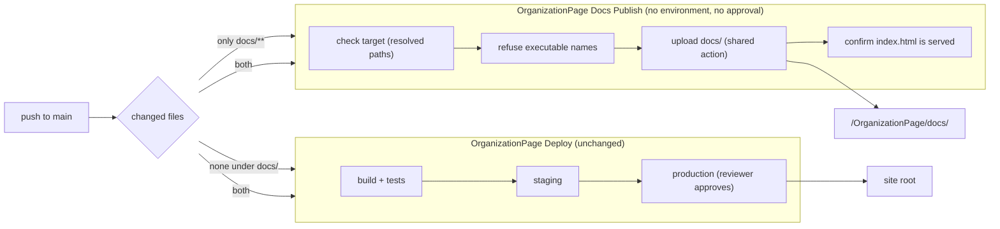

> Superseded by [`plan.md`](../plan.md).

# Plan: publish `docs/` straight to the live site and stop deploying the site for docs-only pushes

**Covers:** SpartanLaboratories/OrganizationPage#8, "Do not start a deployment for documentation-only pushes".
**Architecture:** none. This is one system, the deployment system; its shape is in [Design](#6-design).
**Branch:** `build/issue-8-no-deploy-docs-only` (it exists). This plan document is committed in the same commit as the implementation it describes (commit 1 in [Version control](#11-version-control)).
**Plans:** a `docs/`-only publish path beside the existing staging-and-approval path: one new workflow, one new landing page, a `paths-ignore` filter on the existing deploy workflow, and the policy text that states the exemption.
**Status:** planning only. **Target version:** none; no published artifact changes.

---

## 1. Requirements

1. Everything under `docs/` goes live on a push to `main` with no staging and no approval. This is an explicit exception to deployment rules 1, 2, 3, 5 and 9, limited to `docs/`. Every other change keeps the full staging-and-approval path.
2. All of `docs/` is published, mirrored, at `https://spartanlaboratories.org/OrganizationPage/docs/...`; for example the organization work board is at `/OrganizationPage/docs/plans/org-work-board/`. The upload target is `/spartanlaboratories.org/OrganizationPage/docs` inside the production folder. `/docs/` at the site root stays free. Search engines may index the pages: no `robots.txt`, no `noindex`.
3. The filter is `docs/**` only. `README.md`, `CHANGELOG.md`, `CLAUDE.md` and `LICENSE` keep the full path.
4. A push changing both `docs/` and other files runs both paths independently: `docs/` goes live at once, the rest waits for staging and approval.
5. The existing FTP account is reused, with two checks in the job: the target must be strictly inside the production folder and not the staging folder, and the job refuses to run if `docs/` holds a file the host would execute.
6. The production job, the approval gate and `.github/actions/spaceship-deploy/action.yml` do not change. `ci.yml` does not change.
7. This change lands normally: its own landing is a mixed push, so it starts a full site deployment, and the production reviewer step in that run is unchanged.
8. No link from the website to the boards, no `web`/`server`/`shared` change, and no version bump.

Acceptance: the observations in [Test plan](#9-test-plan) (Integration, End-to-end, UAT) all hold after landing, and the Gating checks pass before the first commit.

## 2. Current state

Baseline: `main` at `21c23eb`; the branch holds only the research commits for this issue on top of it.

- **Today's trigger.** `OrganizationPage Deploy` starts on every push to `main`: `.github/workflows/deploy-spaceship.yml:14-17` has `push.branches: [main]` and no path filter, so a documentation-only push builds, stages, and then waits at the `production` reviewer (`deploy-spaceship.yml:167-179`, gate at `:197-213`).
- **The action refuses a `local-dir` with no `index.html`.** `.github/actions/spaceship-deploy/action.yml:66-69` checks `"$IN_LOCAL_DIR/index.html"`. The check is on the local folder, whatever URL the folder is served at, so `docs/` needs its own `index.html`.
- **The sync is state-based.** `action.yml:127-140` hands `local-dir`, `server-dir` and `dangerous-clean-slate` to `SamKirkland/FTP-Deploy-Action@v4.4.0`, which records what it uploaded in `.ftp-deploy-sync-state.json` inside the target folder and deletes only recorded paths that are gone locally; it never lists the remote folder. Production, staging and the documents folder therefore keep separate records and none removes what another uploaded ([research](../research/ftp-deploy-nested-sync.md)).
- **Live site.** `https://spartanlaboratories.org/OrganizationPage/` and `/OrganizationPage/docs/` return 404 today.
- **Repository configuration.** `SPACESHIP_REMOTE_DIR` is `/../../spartanlaboratories.org/` (it resolves to `/spartanlaboratories.org`), `SPACESHIP_STAGING_REMOTE_DIR` is unset, so staging uses its default `/spartanlaboratories.org/staging` (`deploy-spaceship.yml:40`). The FTP secrets are repository-level; neither environment has its own. `SPACESHIP_FTP_PROTOCOL` is `ftp`, which the action upgrades to `ftps` (`action.yml:80-83`).
- **Nothing under `docs/` feeds the site build.** No Gradle build file, Kotlin source or `Dockerfile` references `docs`; the web module's resources are `web/src/jsMain/resources/index.html` and `favicon.svg`. The site artifact has no top-level `OrganizationPage` or `staging` entry.
- **`docs/` today** holds `DEPLOYMENT.md` and `plans/`. `docs/dashboards/` does not exist at the baseline and `docs/plans/` has no index file. A `find` for the executable names in [Design](#6-design) over `docs/` returns nothing.
- **There is no `CHANGELOG.md`.**
- **Outside facts this unit rests on**, all re-checked at source and linked rather than repeated here:
  - Path filters, push shapes, concurrency, silent absence of a filtered run: [`research/github-path-filters.md`](../research/github-path-filters.md).
  - State file location, first-publish behaviour, default excludes (`.git*`, `node_modules`), partial failure, the swallowed folder-entry failure: [`research/ftp-deploy-nested-sync.md`](../research/ftp-deploy-nested-sync.md).
  - Names and extensions a LiteSpeed cPanel host executes or honours: [`research/host-executable-files.md`](../research/host-executable-files.md).
  - Summary: [`research/README.md`](../research/README.md).

## 3. Assumptions

| Assumption | If false |
|---|---|
| GitHub starts a newly added workflow on the push that adds it, when its `paths` match. This is inferred from the documented mechanics, not stated by GitHub. | The first publish happens at the next push under `docs/`, or by a manual run on `main` (the workflow has `workflow_dispatch`). Nothing else changes. |
| Spaceship's host matches cPanel and LiteSpeed defaults. Its own documentation could not be read; the live `server: LiteSpeed` header is the only direct evidence. | The refusal list only ever refuses more than needed, so it stays safe. A handler mapped onto an inert extension (for example `.html`) at account level is not caught by a name check; the one-time check of a served `.html` and `.md` file under the folder (UAT) is what closes it. |
| `/spartanlaboratories.org/OrganizationPage/docs` resolves for the FTP login the way staging's default path `/spartanlaboratories.org/staging` does. | Set `SPACESHIP_DOCS_REMOTE_DIR` to the path the login sees. |
| The FTP server accepts the `//`-prefixed path the action sends when removing a recorded folder. | A publish that drops a folder fails loudly and leaves the previous sync record in place; the next publish retries against that record. |
| The work and state boards that `docs/index.html` links to are on `main` at landing, except the organization work board (`plans/org-work-board/`), which arrives with its first commit after this landing. Targets that are folders without an index file answer with whatever the host does for a folder (a listing, 403 or 404). | Until the work board lands its link returns 404. A folder link that answers 403 or 404 is a content fix to `docs/index.html` (link to a file, or add an index to that folder), published by the next push under `docs/`. |

## 4. Non-goals

- Serving other repositories' boards.
- Pointing the organization work board's links at the served URLs; they stay GitHub URLs until a later change to its template.
- A dedicated FTP account confined to the documents folder.
- Changing the staging target check's string comparison (SpartanLaboratories/OrganizationPage#9).
- Any change to `ci.yml`, the production job, the approval gate or the shared action.
- A link from the website to the boards, and any `web`, `server` or `shared` change.
- Sharing the folder defaults between the two workflow files through a reusable workflow (see [Risks](#10-risks--edge-cases)).

## 5. Error handling, logging and documentation approach

This unit changes workflow YAML, shell step bodies, HTML and Markdown; there is no Kotlin, so no `Result` types or KDoc are introduced. The equivalents, which the file-by-file section applies to every step:

- **Failure path beside the happy path.** Every expected failure (a bad folder setting, a file the host would execute, a page that is not served) ends the step with `exit 1` and an `::error::` annotation naming the setting or the files, written to stderr. Steps run with `set -euo pipefail`. A programmer error (a missing `docs/index.html`, a malformed workflow) fails the job through the same path or at GitHub's workflow validation. Nothing is recovered silently; the one place the failure is unwrapped is the job's red status on the run page.
- **Events logged.** The `::error::` annotations above; the shared action's own FTP log (`log-level: standard`: first-publish message, per-file uploads, deletes); the served-page check's curl failure; and the final step summary (`Published docs from <sha>` with the live URL). Nothing logs a secret: the credentials only pass as action inputs.
- **Documentation rings.** Ring 1: YAML comments in both workflow files (why the filter exists, when to remove it). Ring 3 (boundary and protocol): `docs/DEPLOYMENT.md`. Ring 4 (topology and policy): `CLAUDE.md` deployment policy, README deployment section and diagram. Ring 2 (KDoc) is not touched: no code.
- **README currency and CHANGELOG.** The change adds a workflow, two variables and a policy exemption, so `README.md` is updated and a `CHANGELOG.md` is created, both in the documentation pass ([commit 2](#11-version-control)).

## 6. Design

**Responsibility.** The deployment system moves repository content to the live host. After this change it has two paths with different guarantees: the **site path** (`deploy-spaceship.yml`: build, staging, approval, production), unchanged except that it ignores pushes that touch only `docs/`; and the **documents path** (`publish-docs.yml`: guard, upload, confirm), the project's one exemption from staging and approval.

**Seams.** Configuration only, no published API, so the stability tiers do not apply.

- Repository variables `SPACESHIP_DOCS_REMOTE_DIR` (default `/spartanlaboratories.org/OrganizationPage/docs`) and `SPACESHIP_DOCS_URL` (default `https://spartanlaboratories.org/OrganizationPage/docs/`), both optional. The documents workflow also reads the existing `SPACESHIP_REMOTE_DIR` and `SPACESHIP_STAGING_REMOTE_DIR`, with the same defaults as the deploy workflow, plus the shared FTP secrets and `SPACESHIP_FTP_*` variables.
- The shared composite action `.github/actions/spaceship-deploy`, consumed unchanged with `clean-remote: "false"`.
- The workflow's `docs/**` path filters, which are the boundary between the two paths.

**How it attaches.** Complementary native filters split every non-empty push exactly: `publish-docs.yml` runs on `paths: docs/**`, `deploy-spaceship.yml` on `paths-ignore: docs/**`; a mixed push starts both, which then run independently with separate concurrency groups (`publish-docs`; `deploy-staging`, `deploy-production`). A pull request landing as a merge commit is judged on everything its branch brought in. The other filtering approach, routing inside one workflow, is not used: it needs a runner on every push to decide anything and would put an unapproved publish into the run that holds the production reviewer ([research](../research/github-path-filters.md)).



**Guards on the documents path** (it has no approval step, so these are what stand in for one):

1. *Target check on resolved paths.* The three folders are resolved with `realpath -m`, because the production folder is configured as `/../../spartanlaboratories.org/`, which is the same folder as `/spartanlaboratories.org/` (the staging check compares strings and would not see that; that is #9). The documents folder must be strictly inside production, and must not be, sit inside, or contain staging. Production resolving to `/` is refused.
2. *Refusal of executable names.* A refusal list, not an allow list: the files are committed and the set of names this stack maps to a handler is small and closed; an allow list would fail the publish on `main` each time a new static type appears ([research](../research/host-executable-files.md)). Matching is case-insensitive and catches inner segments (`report.php.md`), assuming the worse of the two servers' matching rules. The job fails and names each file rather than dropping it, so the shared action's `exclude` input is not used.
3. *Served-page check.* The action treats any failure to enter the target folder as a first publish, which could send the upload to the production folder and put the landing page over the site's `index.html`. A request for `${DOCS_URL}index.html` after the upload makes such a publish fail visibly.

**Why `docs/index.html` is committed.** It satisfies the action's `index.html` check on `docs/` and keeps the check meaningful: a checkout without `docs/` fails before the sync can delete anything, whereas a file generated in the job would pass for a wrong checkout. It is also the landing page of the folder.

**Stage.** A single stage; the pieces are interdependent (the filter without the publish workflow would leave docs unpublished; the workflow without the policy text would contradict `CLAUDE.md`).

## 7. File-by-file changes

### 7.1 `.github/workflows/deploy-spaceship.yml` (changed: one addition)

Under `on.push`, after `branches`, add exactly:

```yaml
    # Files under docs/ are published by publish-docs.yml. Nothing under docs/ feeds the
    # site build, so a push that changes only docs/ starts no staging or production run.
    # If the site build ever reads docs/, remove or narrow this filter.
    paths-ignore:
      - 'docs/**'
```

Nothing else in the file changes: the `workflow_dispatch` trigger, the three jobs, the approval gate and all defaults stay byte-identical. Path filters do not apply to `workflow_dispatch`, so the manual staging button is unaffected. Failure behaviour: not applicable (declarative). `git diff` of the file must show only these five added lines.

### 7.2 `.github/workflows/publish-docs.yml` (new)

Full content:

```yaml
# Publish docs/ to the live site on every push to main that changes it. This is the
# project's one exemption from staging and approval (docs/DEPLOYMENT.md, rule 10); the
# site itself goes through deploy-spaceship.yml.
name: OrganizationPage Docs Publish
run-name: OrganizationPage docs publish of ${{ github.ref_name }}

on:
  push:
    branches:
      - main
    paths:
      - 'docs/**'
  # Re-publish by hand when no push would do it. Only main can publish.
  workflow_dispatch:

permissions:
  contents: read

# Folders are paths as the FTP login sees them. The first two read the same repository
# variables as deploy-spaceship.yml; keep the two files' defaults in step.
env:
  PRODUCTION_REMOTE_DIR: ${{ vars.SPACESHIP_REMOTE_DIR || '/spartanlaboratories.org' }}
  STAGING_REMOTE_DIR: ${{ vars.SPACESHIP_STAGING_REMOTE_DIR || '/spartanlaboratories.org/staging' }}
  DOCS_REMOTE_DIR: ${{ vars.SPACESHIP_DOCS_REMOTE_DIR || '/spartanlaboratories.org/OrganizationPage/docs' }}
  DOCS_URL: ${{ vars.SPACESHIP_DOCS_URL || 'https://spartanlaboratories.org/OrganizationPage/docs/' }}

jobs:
  publish:
    if: ${{ github.ref == 'refs/heads/main' }}
    runs-on: ubuntu-24.04
    # Deliberately no environment: the production environment's required reviewer must not
    # apply to this job.
    concurrency:
      group: publish-docs
      cancel-in-progress: false

    steps:
      - name: Checkout repository
        uses: actions/checkout@v6

      - name: Check publish target
        id: target
        shell: bash
        run: |
          set -euo pipefail

          # Compare resolved paths: the production folder is configured as
          # /../../spartanlaboratories.org/, which is the same folder as /spartanlaboratories.org/.
          canonical() { realpath -m -- "/${1#/}"; }

          docs_dir="$(canonical "$DOCS_REMOTE_DIR")"
          production="$(canonical "$PRODUCTION_REMOTE_DIR")"
          staging="$(canonical "$STAGING_REMOTE_DIR")"

          if [[ "$production" == "/" || "$docs_dir" != "$production"/* ]]; then
            echo "::error::SPACESHIP_DOCS_REMOTE_DIR ($docs_dir) must be strictly inside the production folder ($production)." >&2
            exit 1
          fi

          if [[ "$docs_dir" == "$staging" || "$docs_dir" == "$staging"/* || "$staging" == "$docs_dir"/* ]]; then
            echo "::error::SPACESHIP_DOCS_REMOTE_DIR ($docs_dir) must not be, sit inside, or contain the staging folder ($staging)." >&2
            exit 1
          fi

          echo "remote_dir=$docs_dir/" >> "$GITHUB_OUTPUT"

      - name: Refuse files the server would execute
        shell: bash
        run: |
          set -euo pipefail
          # This path has no approval step, so nothing that runs on the host may reach it.
          bad="$(find docs \( \
              -iname '.htaccess' -o -iname '.htpasswd' -o -iname '.user.ini' -o -iname 'php.ini' \
              -o -iname '*.php*' -o -iname '*.pht*' -o -iname '*.phar*' \
              -o -iname '*.cgi*' -o -iname '*.pl' -o -iname '*.pl.*' -o -iname '*.plx*' \
              -o -iname '*.ppl*' -o -iname '*.perl*' \
              -o -iname '*.shtm*' \) -print)"
          if [[ -n "$bad" ]]; then
            echo "::error::docs/ holds files the server would execute or interpret, so nothing was published:" >&2
            printf '%s\n' "$bad" >&2
            exit 1
          fi

      - name: Publish docs
        uses: ./.github/actions/spaceship-deploy
        with:
          local-dir: docs/
          remote-dir: ${{ steps.target.outputs.remote_dir }}
          server: ${{ secrets.SPACESHIP_FTP_SERVER }}
          username: ${{ secrets.SPACESHIP_FTP_USERNAME }}
          password: ${{ secrets.SPACESHIP_FTP_PASSWORD }}
          protocol: ${{ vars.SPACESHIP_FTP_PROTOCOL }}
          port: ${{ vars.SPACESHIP_FTP_PORT }}
          timeout: ${{ vars.SPACESHIP_FTP_TIMEOUT }}
          # Never clean: the normal sync removes only files this upload put there itself.
          clean-remote: "false"

      - name: Confirm the page is served
        shell: bash
        run: |
          set -euo pipefail
          # The upload action treats a failure to enter the target folder as a first publish,
          # so check that the files arrived where they should.
          curl --fail --silent --show-error --location --max-time 60 --retry 3 --retry-delay 5 \
            --output /dev/null "${DOCS_URL%/}/index.html"

      - name: Summary
        shell: bash
        run: |
          {
            echo "## Published docs from ${GITHUB_SHA::7}"
            echo
            echo "Live at **${DOCS_URL}**"
          } >> "$GITHUB_STEP_SUMMARY"
```

Per-step contract (failure path first):

| Step | On failure | Expected failures (exit 1 + annotation) | Unwrapped at |
|---|---|---|---|
| Check publish target | fails the job before any FTP traffic; no output written | documents folder outside, equal to, or not strictly inside production; production resolves to `/`; documents folder equal to, inside, or containing staging | the run's red status; the annotation names the setting and the resolved paths |
| Refuse files the server would execute | fails the job before any FTP traffic, listing each offending path | any name on the refusal list under `docs/` (a folder counts too) | same |
| Publish docs | the shared action's own validation and FTP errors fail the job; the sync record is written last, so a failed upload leaves the previous record | missing secrets, bad port or protocol, missing `docs/index.html`, FTP errors | same |
| Confirm the page is served | fails the job after the upload; curl retries three times, 60 s each | the landing page not answering 2xx at `${DOCS_URL%/}/index.html` | same; this is the signal for the swallowed folder-entry failure |
| Summary | cannot fail in a way that matters | none | not applicable |

Notes that the implementer must keep as written:

- The job has no `environment:`. Declaring `production` would apply its required reviewer and break the exemption.
- The `if:` on the job makes a manual run on any branch other than `main` a skipped job that does nothing.
- `permissions` is read-only: the job needs no GitHub API access (unlike the production job it has no gate to read).
- `DOCS_URL%/` removes a trailing slash from the variable so the request is `.../docs/index.html` whether or not the variable ends in `/`.
- The two `*_REMOTE_DIR` defaults duplicate `deploy-spaceship.yml:36,40`; the comment above them says so.

### 7.3 `docs/index.html` (new)

A plain static page, no script, title "OrganizationPage documents". Committed so the shared action's `index.html` check holds on `docs/`.

```html
<!DOCTYPE html>
<html lang="en">
<head>
  <meta charset="utf-8">
  <meta name="viewport" content="width=device-width, initial-scale=1">
  <title>OrganizationPage documents</title>
  <style>
    body { font-family: system-ui, sans-serif; max-width: 40rem; margin: 3rem auto; padding: 0 1rem; line-height: 1.5; }
    li { margin: 0.25rem 0; }
  </style>
</head>
<body>
  <h1>OrganizationPage documents</h1>
  <p>These are the boards and documents the OrganizationPage repository keeps under <code>docs/</code>, mirrored from <code>main</code>.</p>
  <ul>
    <li><a href="plans/org-work-board/">Organization work board</a></li>
    <li><a href="plans/">Repository work board</a></li>
    <li><a href="dashboards/">State boards</a></li>
    <li><a href="DEPLOYMENT.md">Deployment reference</a></li>
  </ul>
  <p>
    <a href="https://spartanlaboratories.org/">Spartan Laboratories site</a> &middot;
    <a href="https://github.com/SpartanLaboratories/OrganizationPage">GitHub repository</a>
  </p>
</body>
</html>
```

Relative links keep the page correct at any mount point. The page is public, so it carries nothing but the links above.

### 7.4 `CLAUDE.md` (changed: deployment policy, lines 13-27)

Replace rules 1 and 2 and add rule 10 after rule 9, with exactly this wording (rules 3-9 untouched):

```markdown
1. Every change outside `docs/` goes to a pre-production (staging) environment first and is viewed
   there in a browser before it reaches production.
2. Outside `docs/`, production changes only after a person explicitly approves it. Never add
   automatic, direct, or auto-approved production deploys there, and never skip or weaken an
   approval check.
```

```markdown
10. Files under `docs/` are published straight to the live site by a push to `main` that changes
    them, with no staging and no approval, so the boards stay current. Rules 1, 2, 3, 5 and 9 do
    not apply to that publication. The exemption covers `docs/` and nothing else: every other
    change, including the rest of a push that also changes `docs/`, keeps the full path.
```

The closing paragraph that points at `docs/DEPLOYMENT.md` stays. Hard-wrap at the file's existing width.

### 7.5 `docs/DEPLOYMENT.md` (changed)

1. **Policy rule 1** becomes: "**Staging first.** Every change outside `docs/` goes to staging first and is checked in a browser before it reaches production."
2. **Policy rule 2** becomes: "**A person approves production.** Outside `docs/`, production only changes after a person explicitly approves it: no automatic, direct or auto-approved production deploys, and no skipping or weakening the approval step."
3. **New rule 10** after rule 9: "**`docs/` goes live directly.** A push to `main` that changes a file under `docs/` publishes `docs/` straight to the live site, with no staging and no approval, so the boards stay current. Rules 1, 2, 3, 5 and 9 do not apply to that publication. The exemption covers `docs/` and nothing else: every other change, including the rest of a push that also changes `docs/`, keeps the full path."
4. **Paragraph after the numbered rules:** "A pull request that changes only the generated boards under `docs/plans/` and `docs/dashboards/` may be approved and merged by the automated version control process without the owner's review. This applies to OrganizationPage only."
5. **"Triggers" paragraph** becomes: "**Triggers:** a push to `main` that changes a file outside `docs/` runs staging, then production after approval; a push that changes only files under `docs/` does not start this workflow. A manual run (Actions → OrganizationPage Deploy → Run workflow) on a branch other than `main` deploys to staging only; a manual run on `main` also reaches the production job and waits for approval there."
6. **New subsection `### Documents workflow`**, placed after the paragraph describing `ci.yml` and before `### Approval`, covering in prose:
   - `.github/workflows/publish-docs.yml`, named **"OrganizationPage Docs Publish"**, uploads `docs/` to the documents folder on every push to `main` that changes a file under `docs/`; it implements rule 10.
   - It has no staging step and declares no GitHub environment, so the `production` environment's required reviewer does not apply to it.
   - Its three guards: the target check on resolved paths (documents folder strictly inside production, clear of staging), the refusal of files the server would execute or interpret (names listed in the workflow; the job names each file and publishes nothing), and the served-page check after the upload (a request for the landing page).
   - A push that changes both `docs/` and other files runs both workflows independently: `docs/` goes live at once, the rest waits for staging and approval.
   - A workflow that a push does not match leaves no entry in the Actions list: no run, no skipped entry. A docs-only push therefore shows no "OrganizationPage Deploy" run, and a push with nothing under `docs/` shows no "OrganizationPage Docs Publish" run. That is expected.
   - To republish by hand: Actions → OrganizationPage Docs Publish → Run workflow on `main`. A run on any other branch does nothing.
7. **Hosting table** gains a row: `Documents | /spartanlaboratories.org/OrganizationPage/docs | https://spartanlaboratories.org/OrganizationPage/docs/`.
8. **The list after the hosting table**, "Because staging sits inside the production folder", becomes "Because staging and the published documents sit inside the production folder", with these items:
   - production deploys never wipe their folder (a clean-slate upload would delete staging and the published documents); their normal sync only removes files they uploaded themselves;
   - the manual "clean" option applies to staging only, and the documents folder can never be inside the staging folder, so it cannot wipe the documents;
   - the staging folder must differ from the production folder, and neither can be the FTP root;
   - the documents folder must be strictly inside the production folder and must not be, sit inside, or contain the staging folder;
   - each of the three folders keeps its own sync record (`.ftp-deploy-sync-state.json` in the folder), so no sync removes what another uploaded;
   - the site's build output must never contain a top-level `OrganizationPage` or `staging` entry: a later build without it would make production's sync remove that whole folder, with the documents or staging in it.
9. **Secrets and variables:** the FTP secrets are used by the site deployment's staging and production jobs and by the documents publish. Add the optional variables `SPACESHIP_DOCS_REMOTE_DIR` and `SPACESHIP_DOCS_URL` to the list, with a pointer to the README table.
10. **"Operating it"** gains two bullets: removing a published document means deleting it from `docs/` on `main`, and the next publish removes it from the site; `/build-info.json` describes the site build only, so it says nothing about the documents.
11. **"Deploy mechanism"**: "for both staging and production" (line 70) becomes "for staging, production and the published documents".

### 7.6 Files not changed

`.github/actions/spaceship-deploy/action.yml`, `.github/workflows/ci.yml`, the production job and the approval gate in `deploy-spaceship.yml`, and every file under `web/`, `server/`, `shared/` stay as they are. `docs/plans/org-work-board/` and the issue board files in this plan's folder belong to other work and are not touched.

### 7.7 Documentation pass: `README.md` and `CHANGELOG.md` (commit 2, not part of the implementation commit)

`README.md`:

- Lines 74-76 become: "Every change outside `docs/` goes to a pre-production **staging** site first. Production only changes after someone has looked at staging and approved it. Files under `docs/` are the one exemption: a push to `main` that changes them publishes them straight to the live site, with no staging and no approval. The deployment policy and the full reference for how it is implemented are in [docs/DEPLOYMENT.md](docs/DEPLOYMENT.md)."
- Line 79, the diagram, stays: it draws a push that deploys, and the sentence directly below it carries the exception.
- Line 82 becomes: "`.github/workflows/deploy-spaceship.yml` ("OrganizationPage Deploy") runs on every push to `main` that changes a file outside `docs/`:"
- A new short paragraph in that section, after the paragraph about the production job's reviewer check (lines 93-95) and before "Staging a branch": "`.github/workflows/publish-docs.yml` ("OrganizationPage Docs Publish") uploads `docs/` to https://spartanlaboratories.org/OrganizationPage/docs/ on every push to `main` that changes a file under `docs/`, with no staging and no approval; a push that changes both runs both."
- In the one-time setup's secrets item (lines 123-124), "Both sites use these." becomes "Both sites and the documents publish use these."
- The variables table (lines 128-136) gains, in the same style as the first four rows: `SPACESHIP_DOCS_REMOTE_DIR` (default `/spartanlaboratories.org/OrganizationPage/docs`; "Documents folder. Must be strictly inside the production folder and clear of the staging folder.") and `SPACESHIP_DOCS_URL` (default `https://spartanlaboratories.org/OrganizationPage/docs/`; "Documents address, shown in the run summary and used to confirm the upload").

`CHANGELOG.md` (new, Keep a Changelog layout, no version heading because nothing is bumped):

```markdown
# Changelog

All notable changes to this project are documented in this file.

The format is based on [Keep a Changelog](https://keepachangelog.com/en/1.1.0/).

## [Unreleased]

### Added

- Documents under `docs/` publish to https://spartanlaboratories.org/OrganizationPage/docs/ on a push to `main`, with no staging and no approval (`OrganizationPage Docs Publish`).

### Changed

- Site deployment no longer starts for a push that changes only `docs/`.
```

## 8. Documentation impact

| Ring | What moves |
|---|---|
| 1, in-editor | Comments in `deploy-spaceship.yml` (filter) and `publish-docs.yml` (header, defaults, no environment, never clean, served-page check) |
| 2, component API | None: no code, no KDoc |
| 3, boundary and protocol | `docs/DEPLOYMENT.md` (7.5): policy, triggers, documents workflow, hosting, shared-folder rules, variables, operating notes |
| 4, topology and policy | `CLAUDE.md` rules 1, 2, 10 (7.4); README deployment section, diagram sentence and variables table (7.7) |
| README currency | Updated in commit 2, because the change adds a workflow, two variables and a policy exemption |
| CHANGELOG | Created in commit 2 |

## 9. Test plan

No Gradle suite runs. No module's code changes, so no module test belongs to this change; the Component and Deterministic levels have nothing to exercise. A compile is not needed either: no `web`, `server` or `shared` file changes, which `git diff --stat` shows.

### Gating (local, before committing; nothing is committed as a test)

1. **`actionlint`** on `.github/workflows/deploy-spaceship.yml` and `.github/workflows/publish-docs.yml`. It is not installed on this machine: download its release binary (from `github.com/rhysd/actionlint` releases) into a temporary folder outside the repository, run it with the repository path as an argument, and do not install it anywhere else. Expect no findings.
2. **Diff scope:** `git diff -- .github/workflows/deploy-spaceship.yml` shows exactly the five added lines of 7.1; `git status` shows no change to `action.yml`, `ci.yml` or any module.
3. **"Check publish target" body**, extracted from the committed `publish-docs.yml`, run in bash with `GITHUB_OUTPUT` pointed at a temporary file, `PRODUCTION_REMOTE_DIR=/../../spartanlaboratories.org/`, `STAGING_REMOTE_DIR=/spartanlaboratories.org/staging`:

   | `DOCS_REMOTE_DIR` | Expected |
   |---|---|
   | `/spartanlaboratories.org/OrganizationPage/docs` | accepted, output `remote_dir=/spartanlaboratories.org/OrganizationPage/docs/` |
   | `/../../spartanlaboratories.org/OrganizationPage/docs/` | accepted, same output |
   | `/spartanlaboratories.org` | refused (not strictly inside production) |
   | `/spartanlaboratories.org/` | refused |
   | `/` | refused |
   | `/spartanlaboratories.org/x/../` | refused (resolves to production itself) |
   | `/spartanlaboratories.org/staging` | refused (is staging) |
   | `/spartanlaboratories.org/staging/docs` | refused (inside staging) |
   | `/elsewhere/docs` | refused (outside production) |

   Plus one run with `DOCS_REMOTE_DIR=/spartanlaboratories.org/OrganizationPage/docs` and `STAGING_REMOTE_DIR=/spartanlaboratories.org/OrganizationPage/docs/staging`: refused (contains staging). A refused run exits non-zero and writes nothing to `GITHUB_OUTPUT`.
4. **"Refuse files the server would execute" body**, extracted from the committed file, run from a scratch folder holding a `docs/` tree with one file at a time. Each of `.htaccess`, `a.PHP`, `a.php.md`, `a.phtml`, `a.phar`, `a.cgi`, `a.pl`, `a.pl.txt`, `a.shtml`, `php.ini`, `.user.ini` causes a refusal that prints its path. Each of `index.html`, `board.js`, `plan.json`, `README.md`, `workspace.dsl`, `x.plantuml`, `x.puml`, `x.py`, `plan.md` does not.
5. **The same `find` over the real `docs/`** returns nothing. Re-run it immediately before commit 1, since generated boards add files to `docs/`.

### Component, Deterministic

Not applicable: no Kotlin or Gradle code changes, and the shell bodies are covered at Gating.

### Integration, End-to-end, UAT

Observations on the real system after landing. They cannot be automated here, because they need the live host, the FTP account and the Actions run history.

1. **Landing push.** It changes files outside `docs/`, so it starts one `OrganizationPage Deploy` run (staging, then production waiting at the reviewer step, unchanged). If the first assumption holds it also starts one `OrganizationPage Docs Publish` run; otherwise run that workflow by hand on `main`.
2. **Publish log.** The upload step prints the first-publish message followed by uploads; the served-page step and the summary succeed.
3. **Served.** `https://spartanlaboratories.org/OrganizationPage/docs/` returns 200 and shows the landing page.
4. **Nothing else disturbed.** `https://spartanlaboratories.org/.ftp-deploy-sync-state.json` still lists only the site's files (no `docs` entries) and `https://spartanlaboratories.org/staging/` is still served.
5. **Static serving.** One `.html` and one `.md` file under the folder come back unmodified (not executed, not rewritten); this closes the account-level handler assumption.
6. **Filtering.** The first push that changes only `docs/` after landing starts a publish run and no deployment run. A push with nothing under `docs/` starts no publish run.
7. **Links.** The landing page's four relative links answer as the last assumption describes.

## 10. Risks & edge cases

- **Public at once.** Anything merged under `docs/` is live on the merge, with no review step, including a boards-only pull request merged by the automated process without the owner. Nothing sensitive may be committed under `docs/`. The refusal list stops files the host would run; it does not stop any other content. The sync state file `.ftp-deploy-sync-state.json` in the folder is also publicly readable, as production's already is; it lists file names, sizes and hashes only.
- **Swallowed folder-entry failure.** If the action's change into the target folder fails after a failed create, it carries on in the last folder it reached, which could be the production folder, putting the landing page and a sync record there ([research](../research/ftp-deploy-nested-sync.md)). Detection: the served-page step requests `.../OrganizationPage/docs/index.html`, which returns 404 in that case, so the run is red. The same `ensureDir` call already created `staging/` on this account, so this is unlikely. Recovery: re-run the `production` job of the latest successful `main` deployment run and approve it (the rollback procedure in `docs/DEPLOYMENT.md`); by the sync rules it restores the site's `index.html`, and because the stray sync record lists the stray document files it also removes them. Check the site after the re-run to confirm.
- **Partial failure and orphans.** The sync record is written last, so a failed publish leaves the previous record and a re-run recomputes against it. Files that a failed run uploaded and that are removed from the repository before the next successful publish stay on the server (no record lists them); remove them by hand through FTP or the host's file manager.
- **Empty or partial `docs/`.** A publish deletes every recorded file missing locally. A checkout always has the full `docs/`; a commit that deletes content deletes it from the site, which is the intended removal path. `docs/index.html` being committed makes a checkout without `docs/` fail before the sync runs.
- **Stale publish race.** Publishes share the `publish-docs` group with `cancel-in-progress: false`: one runs, the newest waits, and an older waiting run is cancelled, which loses nothing because each run uploads the whole folder. GitHub does not guarantee queue order, so an older commit could upload after a newer one in a narrow window. Repair: the next push under `docs/`, or a manual run on `main`.
- **Two uploads at once.** A mixed push runs the documents publish and the site's staging upload concurrently against the same host, each in its own group (`publish-docs`, `deploy-staging`) and each with its own sync record. A connection limit on the account could fail one of them with a login error; re-run the failed job.
- **Wide FTP account.** The reused account can write the whole site, so the two checks (target, executable names) are the only fence, and they live in the workflow file on `main`. Anyone who can change that file on `main` can change them; a dedicated account confined to the documents folder is a recorded follow-up.
- **Duplicated folder defaults.** The production and staging defaults appear in both workflow files. The repository variables, which both read, are the live configuration (`SPACESHIP_REMOTE_DIR` is set; the staging variable is unset), so the duplication matters only when a default changes: change both files together. The comment above the `env` block says so.
- **Silent absence of a run.** A workflow that a push does not match leaves no run, no skipped entry and no check on a branch with no required checks, so a missing run looks like a failure to start. `docs/DEPLOYMENT.md` documents this (7.5, item 6). `main` has no branch protection or required checks today; if one is ever added that requires either workflow, a filtered push would leave that check pending.
- **Site artifact top-level names.** The site build must never output a top-level `OrganizationPage` or `staging` entry; a later build without it would make production's sync remove that folder recursively, documents included. The rule is written into `docs/DEPLOYMENT.md` (7.5, item 8).
- **Filter assumption.** The `paths-ignore` comment says to remove or narrow the filter if the site build ever reads `docs/`; a build that reads it would otherwise silently stop deploying changes to it.
- **Landing run.** The landing starts a full site deployment that stops at the `production` reviewer; that run is the owner's to review and approve like any other. Rule 9 still applies to it.
- **Dot-named paths.** GitHub does not state whether `docs/**` expands into dot-named children; `docs/` tracks none, so no filter result depends on it.
- **Compatibility.** No wire, schema or API change. Existing consumers of the site see no difference; the new folder is additive. Cross-repo impact: none.

## 11. Version control

- **Branch:** `build/issue-8-no-deploy-docs-only`.
- **Commit 1, `ci:`** carries `.github/workflows/publish-docs.yml`, the filter in `.github/workflows/deploy-spaceship.yml`, `docs/index.html`, `CLAUDE.md`, `docs/DEPLOYMENT.md` and this plan (`docs/plans/8-docs-only-deploy-skip/plan.md`), so `git log --follow` binds the plan to the implementation. The type is `ci:` because the change is workflow and configuration with no effect on any published artifact.
- **Commit 2, `docs:`** carries the `README.md` and `CHANGELOG.md` deltas of 7.7, written in the documentation pass after the implementation is done, with `consequences.md` and `final-implementation.md` as they stand at that point.
- No version bump and no tag: no published artifact changes.
- Both commits ride the same pull request and land as one merge, so the landing is one mixed push and starts one deployment run and (by the first assumption) one publish run.
- **Not carried into commit 1:** the generated issue board files in this plan's folder (`dashboard.html`, `plan.js`, `plan.json`). The untracked `docs/plans/org-work-board/` stays out of both commits.

## 12. Interfaces with sibling units

None: this is the only unit of the work, and no other unit is planned against it. Neighbouring work it must not disturb or depend on:

- `docs/plans/org-work-board/` (organization work board) and the boards under `docs/plans/` and `docs/dashboards/`: provided to them, a place they are served; expected from them, nothing, except that every file they add under `docs/` avoids the refused names. Their first commit after this landing makes the work board link in `docs/index.html` resolve.
- SpartanLaboratories/OrganizationPage#9 (the staging target check's string comparison): this unit's target check resolves paths and does not edit the staging check; #9 is not blocked by or blocking this.

## 13. Sequencing & follow-ups

1. Gating checks, then commit 1, then commit 2 on the branch; open the pull request.
2. The landing starts its deployment run; rule 9's go-ahead covers that run, and the owner views staging and approves production in it as usual.
3. After landing, make the Integration, End-to-end and UAT observations.
4. Follow-ups, deliberately left for later:
   - the organization work board's links pointing at the served URLs;
   - a dedicated FTP account confined to the documents folder;
   - the staging target check's string comparison (#9);
   - sharing the folder defaults between the two workflow files if a third consumer appears.

## 14. Considerations

None. Every call this unit needed is settled in the requirements; the points that remain open (link targets that are folders, the first-push assumption, the account-level handler assumption) are assumptions with a stated consequence, not trade-offs for the owner.
